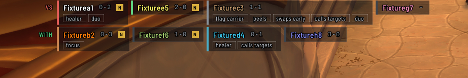
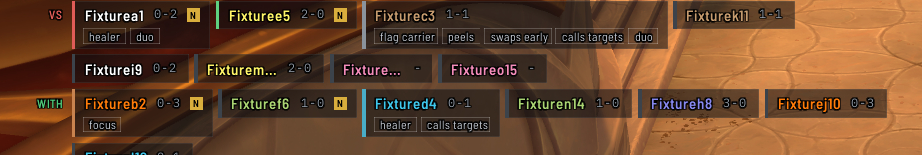
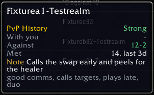
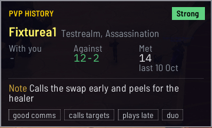
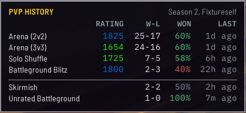
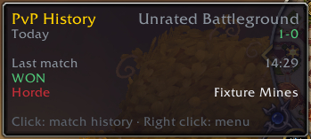

# Alerts

The addon can tell you when you meet someone you've played with before, and remind you what you wrote
about them. Everything here is shown only to you: nothing is ever sent to a chat channel.

## The short version

- When you meet someone you've played with before, the addon tells you: in chat, across your screen at
  the start of a match, and on their tooltip.
- None of it is shown to anyone else.
- Each alert has its own off switch. The table under
  [How do I stop the pop-ups and chat lines?](Questions#how-do-i-stop-the-pop-ups-and-chat-lines) lists
  them.

## When someone joins your group

When your group changes, a line in chat says how many of the group are already in your history. With
group notes on, whoever joined is named under it with your rep, tags and note on them. Each name in
these lines is a link: click it to open [that player's window](Players-and-Notes#one-player). Turning a
party into a raid with the same people says nothing new.

After a match, one line says the match was recorded and how many of its players you have met before, and
a link under it opens the match. After a rated match the line names your rating going in and coming out,
the change and your MMR after, such as `rating 1850 to 1864 (+14), MMR 1902`, and a match that beats one
of your [bests](Ask#the-bests-view) for that spec adds a line naming it. See
[Writing a note right after a match](Players-and-Notes#writing-a-note-right-after-a-match). **Chat after
a match** and `/pvph postgame off` turn those lines off, and a line reporting a fault prints either way.

**In a battleground, the line comes at the gates.** The group the game puts you in there is only known
once the match's players are, so the addon names the people on your side you've played with before at
the start of the match rather than as they join.

**Somebody you have played with before joining your group also raises the names on screen**, the same
way the start of a match does. It rises only when somebody new arrives, so leaving the group and
people leaving it raise nothing, and it never rises while you are inside a battleground or an arena.
The names have their own switch, so they can rise with the chat lines turned off.

- `/pvph alert off` stops these lines, and `/pvph alert on` brings them back.
- `/pvph groupnotes off` stops the names and notes under them, and `/pvph groupnotes on` brings them back.

## At the start of a match

At the gates, once the players in the match are known and your history already holds one of them, their
names appear across the upper part of your screen and then fade. Your opponents are listed after **VS**
and your side after **WITH**.

Each player you know is a small panel:

- a stripe down its left edge in the color of the rep you gave them
- their name, in their class color, without the realm
- your record with them, such as `2-0`, or `-` where none of those matches had a result. After **VS**
  it counts the matches they played against you, and after **WITH** the matches they played with you.
- a gold `N` where you've written a note on them
- their tags, on a line under the name

The text of the note is in the [player's window](Players-and-Notes#one-player).

**Anybody you have played a saved match with counts**, not only people you have written about. A tag on
its own doesn't. Everybody you know is listed. It doesn't block your mouse, so you can click straight
through it, unless you unlock it (see below).

### Its shape

**Side by side** puts both sides on one line where they fit, with a thin rule between them, and is how
it starts. **One column** puts each side on a line of its own. Pick one with **Shape** under **ALERTS**
in the [settings](Settings-and-Storage). In either shape, a side too long for its line carries on under
it.

### How long it stays up

Four seconds, plus one for each player and one for each line of tags. One player with no tags is 5
seconds, and it stops growing at fifteen lines, which is 19 seconds.

`/pvph announce time` and a percentage from 50 to 300 stretches or shortens all of that together. Bare,
`/pvph announce time` says what a full banner lasts at your setting.

### How large it is

`/pvph announce size` and a percentage from 75 to 150 sets how large it is drawn.

**Where the banner would run past the edge of your screen, it draws smaller to fit**, down to half its
size. Bare, `/pvph announce size` says the size it actually drew at if that was smaller than the one you
set.

### How dark the panels are

`/pvph announce opacity` and a percentage from 0 to 100 sets how dark each player's panel is. It starts
at 85. A change shows at once on a preview you are holding.

Time, size and opacity are also sliders in the game's own settings, as **Announcement time**,
**Announcement size** and **Announcement opacity**, and steppers under **ALERTS** in the
[settings](Settings-and-Storage), as **Time**, **Size** and **Opacity**.

### Moving it

1. Type `/pvph announce preview`, or click **Preview** beside **Position** in the settings. A sample
   appears with made-up names and stays on screen. `/pvph announce preview full` shows a long sample of
   fifteen, so you can see how a full side wraps.
2. Drag it to where you want it.
3. Type `/pvph announce preview` again, or press Escape, to put it away. Its new position is kept.

`/pvph announce reset`, or **Reset** beside **Position**, puts it back in its original spot. You can
preview it even while it's turned off, to decide whether you want it.

**To move it without waiting for a match**, turn off **Lock** beside **Position** and keep the settings
open. A dark plate carrying the word `Announcement` appears where the names will be, and you can drag
it there. It goes when you close the settings, when you turn **Lock** on again, and while a preview or a
real banner is up, and it comes back when those end with the settings still open.

**To move it during a match**, turn off **Lock**. The next banner then takes your mouse: drag it while
it's up, and it stops fading while you hold it. Where you drop it is kept. Turn **Lock** on again to let
your clicks go through it.

`/pvph announce off` turns it off, and `/pvph announce on` turns it back on.

## When someone you wrote about appears

Outside a battleground or an arena, a player you've rated, tagged, noted or commented on gets a small
PvPHistory mark on their nameplate when it appears, and one line in chat names them, `<player> is
here`, followed by your rep, tags and note on them, or how many comments you left. The line comes at
most once every ten minutes for the same player. Targeting them prints the line too. Your group and
your own characters are never marked.

**Mark people you have written about when they appear**, under **ALERTS** in the
[settings](Settings-and-Storage), turns it off, and so does `/pvph sight off`. `/pvph sight` alone says
whether it's on and how many nameplates carry a mark.

## In chat

When a player you've rated, tagged, noted or commented on talks in chat, a thin bar stands before their
name, in the color of your rep on them, or a faint one where you wrote about them without a rep. Only
you see it: nothing is sent to the channel. Your own lines get no bar. The game hides who is talking
from addons during a match, a dungeon or a raid, so the bar doesn't show there.

**Mark people you have written about in chat**, under **ALERTS** in the
[settings](Settings-and-Storage), turns it off, and so does `/pvph chatmark off`. It's a switch of its
own, so you can keep the nameplate mark without the chat bar, or the other way around.
`/pvph chatmark sample` prints one line in each color the bar takes.

## On tooltips

Hovering over a player you know adds a block to their tooltip, under a blank line. Its first line reads
**PvPHistory**, with your rep on them at the right, or **Not rated**. Under it come **With you**,
**Against** and **Met**, your note, your tags, and **Last seen at** with the rating they had and its
format. Players the addon knows nothing about get nothing added, and neither do your own characters.

`/pvph tooltip off` stops this, and `/pvph tooltip on` brings it back.

## In the group finder

**When someone applies to your group**, hovering their name in the group finder shows a card from your
history: your rep on them, their name, realm and spec, your record **With you** and **Against** them,
how many times you've **Met** and when, and your note and tags. Someone you've never met reads
`Not met before.`, and your own characters get no card. `/pvph card` and a name shows the card for that
name, and `/pvph card` alone hides it.

**Open the group finder's Player vs. Player tab** and a small panel sits above the finder, lined up with
its right edge, with this character's record for the season. Where the screen has no room above the
finder, it sits beside it instead. It's headed **PVP HISTORY** with the season and the character, then
a row for each format you played this season under **RATING**, **W-L**, **WON** and **LAST**, rated
formats first and unrated ones under a line. Your rating is in the color of your tier. On World PvP,
**W-L** is your kills and deaths. **Season record beside the group finder**, under **HISTORY** in the
[settings](Settings-and-Storage), turns it off. `/pvph finder` says what the last look decided, and
`/pvph finder on` or `off` holds a choice until you log out or reload.

**To put the panel somewhere else**, turn off **Dock the season record to the group finder**, under
**HISTORY** in the settings. Then drag the panel with the left mouse button, and it opens where you
dropped it each time you open the Player vs. Player tab. `/pvph finder undock` and `/pvph finder dock`
try either until you log out or reload, and `/pvph finder reset` forgets where you dropped it.

## The minimap button

Hover the minimap button to see today at a glance, for the format you played last: your **Rating** with
today's change, **Today** with your wins and losses, and your **Last match** in three lines: when it was,
how it went with the rating change in its color, and your side in its faction color beside the map.
After a format with no rating, such as an unrated battleground, there is no **Rating** line and no
rating change. Click it to open your history.

Right-click it for a menu: **Match history**, **Players** with how many players you've met, **Stats**,
**Settings**, **Reset button position** and **Hide this button**.

## When a match ends

With **Hold the exit while the scoreboard is read** on, the leave button is covered for a few seconds
when a match ends, reading `Saving the match` and the seconds left, so the addon can finish reading the
scoreboard. It turns to `Saved` and the match's number for a moment, with the rating change beside it
after a rated match, in green for a gain and red for a loss, then lets go.
`/pvph hold preview saving` shows the cover so you can see it, and `/pvph hold preview off` takes it
away.

## At login

`/pvph login on` makes the addon say which version loaded each time you log in, and `/pvph login off`
stops it.

If something needs your attention, such as a problem with your saved history or a backup that couldn't
be made, the addon says that first, and skips its routine "loaded" line so the important message isn't
buried. A match you left in your last session is mentioned too.
