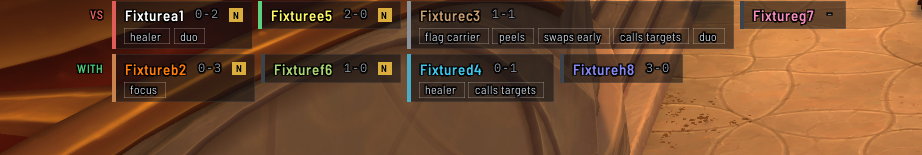
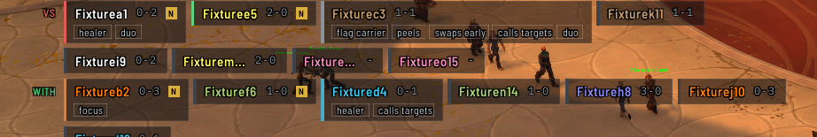
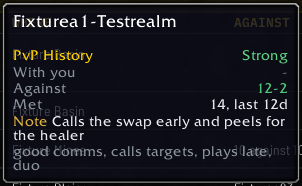
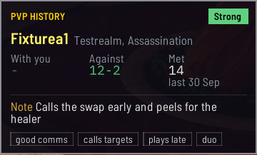
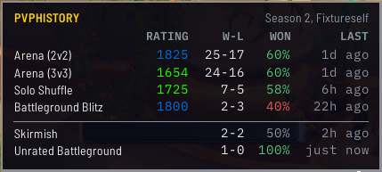
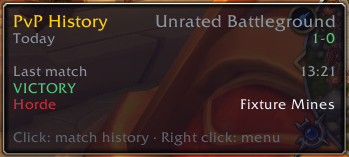

# Alerts

The addon can tell you when you meet someone you've played with before, and remind you what you wrote
about them. Everything here is shown only to you: nothing is ever sent to a chat channel.

## The short version

- When you meet someone you've played with before, the addon tells you: in chat, across your screen at
  the start of a match, and on their tooltip.
- None of it is shown to anyone else.
- Each alert has its own off switch. The table under
  [How do I stop the pop-ups and chat lines?](Questions#how-do-i-stop-the-pop-ups-and-chat-lines) lists
  them.

## When someone joins your group

When your group changes, a line in chat says how many of the group are already in your history. With
group notes on, whoever joined is named under it with your skill, attitude, tags and note on them. Each name in
these lines is a link: click it to open [that player's window](Players-and-Notes#one-player). Turning a
party into a raid with the same people says nothing new.

After a match, one line says the match was recorded and how many of its players you have met before, and
the line under it carries two links: **Open match** opens the match, and **Rate players** opens the
players window on everyone in it. After a rated match the line names your rating going in and coming out,
the change and your MMR after, such as `rating 1850 to 1864 (+14), MMR 1902`, and a match that beats one
of your [bests](Ask#the-bests-view) for that spec adds a line naming it. Once two results in a row are the
same, the line ends on your streak, such as `W3` or `3 losses in a row`. See
[Writing a note right after a match](Players-and-Notes#writing-a-note-right-after-a-match). **Chat line
after a match** and `/pvph postgame off` turn those lines off, and a line reporting a fault prints either way.

**Say so after N losses**, under **Chat line after a match**, adds one line when you lose that many
matches in a row in one format, such as `3 in a row. A break is a setting away.` It says so once for each
run. It's off to start. `/pvph postgame nudge` and a number from 2 to 10 sets it, `/pvph postgame nudge
off` turns it off, and `/pvph postgame nudge` alone says what it is.

**In a battleground, the line comes at the gates.** The group the game puts you in there is only known
once the match's players are, so the addon names the people on your side you've played with before at
the start of the match rather than as they join.

**Somebody you have played with before joining your group also raises the names on screen**, the same
way the start of a match does. It rises only when somebody new arrives, so leaving the group and
people leaving it raise nothing, and it never rises while you are inside a battleground or an arena.
The names have their own switch, so they can rise with the chat lines turned off.

- `/pvph alert off` stops these lines, and `/pvph alert on` brings them back.
- `/pvph groupnotes off` stops the names and notes under them, and `/pvph groupnotes on` brings them back.

## At the start of a match

At the gates, once the players in the match are known and your history already holds one of them, their
names appear in the upper part of your screen and then fade. It starts as a card: your opponents under
**ENEMIES** and your side under **ALLIES**, each with how many you know.

Each player you know is a row on the card:

- a stripe down its left edge in the color of the skill you gave them, or of their attitude where it is one of the two lowest steps
- their name, in their class color, without the realm
- the skill and attitude you gave them as words, such as `weak` or `friendly`
- your record with them at the right, such as `2-0`, or `-` where none of those matches had a result.
  Under **ENEMIES** it counts the matches they played against you, and under **ALLIES** the matches they
  played with you.
- under the name, the first line of your note in gold, or their tags where you wrote no note

The whole note is in the [player's window](Players-and-Notes#one-player).

**A crowded lobby is one line instead.** Where you know more players than **Headline above** allows, six
to start, the card becomes a single line naming the two that matter most on each side, notes and the
worst reps first, and counting the rest: `ENEMIES 8: Name, Name and 6 more | ALLIES 7: ...`. Set
**Headline above** under **AT THE GATES**, or type `/pvph announce crowd` and a number from 2 to 15. At 15
the card is always drawn.

**To see it again after it fades**, press the key you set for **Show the last announcement** in the game's
key bindings, under PvPHistory, or type `/pvph announce last`. It draws the last one as the card.

**Anybody you have played a saved match with counts**, not only people you have written about. A tag on
its own doesn't. Everybody you know is listed. It doesn't block your mouse, so you can click straight
through it, unless you unlock it (see below).

### What your history says about the lobby

The card can carry three more things, read from your saved matches:

- **ENEMY COMP**, above **ENEMIES**: the other team's classes, such as Mage + Rogue, and your record
  against those classes, such as `2-7 against you`, with `this season, by class` under it. It shows
  only where you have five or more matches with a result against those classes and haven't won more
  than you lost. It goes by class, since the game hides the specs until the match ends.
- **A rematch line** under it, such as `Met this lobby 20 min ago, you lost`, where two or more
  of the players were in a match with you this sitting.
- **When you last met** each player you know, at the right of their row under your record, such
  as `3 d ago, lost` or `yesterday, won`.

The **Headline** layout adds the comp record after the enemies, such as `comp 2-7`. **Side by side**
and **One column** draw none of the three. Turn the first two off with **Warn on a comp you lose to**
and **Say when the other team played you earlier this sitting** under **Announce who you know**, or
`/pvph announce comp off` and `/pvph announce rematch off` (`on` turns them back on).

### Its shape

Pick one with **Layout** under **AT THE GATES** on the **Alerts** page of the
[settings](Settings-and-Storage):

- **Card**, the one described above, and how it starts.
- **Headline**, the single line, however many you know.
- **Side by side** and **One column** draw a strip of small panels instead, your opponents after **VS**
  and your side after **WITH**, each panel with the skill's stripe, the name, your record, a gold `N` where
  you wrote a note and the tags under the name. **Side by side** puts both sides on one line where they
  fit; **One column** gives each side a line of its own. A side too long for its line carries on under it.

### How long it stays up

5 seconds to start, however many players it shows. `/pvph announce time` and a number of seconds from 2 to 30
sets it, and bare, it says how long it stays up. A time you set before this was a number of seconds is kept at
what it gave one player.

### How large it is

`/pvph announce size` and a percentage from 75 to 150 sets how large it is drawn.

**Where the banner would run past the edge of your screen, it draws smaller to fit**, down to half its
size. Bare, `/pvph announce size` says the size it actually drew at if that was smaller than the one you
set.

### How dark the panels are

`/pvph announce opacity` and a percentage from 0 to 100 sets how dark each player's panel is. It starts
at 85. A change shows at once on a preview you are holding.

The time, size and opacity are also sliders in the game's own settings, as **Announcement time**,
**Announcement size** and **Announcement opacity**, and steppers under **AT THE GATES** on the
**Alerts** page of the [settings](Settings-and-Storage), as **Shown for**, **Size** and **Opacity**. A
small picture beside them draws one player for each side at the size of the words beside it, to show
how the names will look.

### Moving it

1. Type `/pvph announce preview`, or click **Preview** beside **Position** in the settings. A sample
   appears with made-up names and stays on screen. `/pvph announce preview full` shows a long sample of
   fifteen, so you can see how a full side wraps.
2. Drag it to where you want it.
3. Type `/pvph announce preview` again, or press Escape, to put it away. Its new position is kept.

`/pvph announce reset`, or **Reset** beside **Position**, puts it back in its original spot. You can
preview it even while it's turned off, to decide whether you want it.

**To move it without waiting for a match**, turn off **Lock** beside **Position** and keep the settings
open. A dark plate carrying the word `Announcement` appears where the names will be, and you can drag
it there. It goes when you close the settings, when you turn **Lock** on again, and while a preview or a
real banner is up, and it comes back when those end with the settings still open.

**To move it during a match**, turn off **Lock**. The next banner then takes your mouse: drag it while
it's up, and it stops fading while you hold it. Where you drop it is kept. Turn **Lock** on again to let
your clicks go through it.

`/pvph announce off` turns it off, and `/pvph announce on` turns it back on.

## When someone you wrote about appears

Outside a battleground or an arena, a player you've rated, tagged, noted or commented on gets a small
PvPHistory mark on their nameplate when it appears, and one line in chat names them, `<player> is
here`, followed by your skill, attitude, tags and note on them, or how many comments you left. The line comes at
most once every ten minutes for the same player. Targeting them prints the line too. Your group and
your own characters are never marked.

**A mark on their nameplate**, under **ON NAMEPLATES** on the **Notes and players** page of the
[settings](Settings-and-Storage), turns it off, and so does `/pvph sight off`. `/pvph sight` alone says
whether it's on and how many nameplates carry a mark.

## In chat

When a player you've rated, tagged, noted or commented on talks in chat, a thin bar stands before their
name, in the color of your skill rating on them, or of your attitude rating where it is one of the two lowest steps, or a faint one where you wrote about them without rating them. Only
you see it: nothing is sent to the channel. Your own lines get no bar. The game hides who is talking
from addons during a match, a dungeon or a raid, so the bar doesn't show there.

**A bar before their name**, under **IN CHAT** on the **Notes and players** page of the
[settings](Settings-and-Storage), turns it off, and so does `/pvph chatmark off`. It's a switch of its
own, so you can keep the nameplate mark without the chat bar, or the other way around.
`/pvph chatmark sample` prints one line in each color the bar takes.

## On tooltips

Hovering over a player you know adds a block to their tooltip, under a blank line. Its first line reads
**PvPHistory**, with your skill and attitude on them at the right, or **Not rated**. Under it come **With you**,
**Against** and **Met**, your note, your tags, and **Last seen at** with the rating they had and its
format. Players the addon knows nothing about get nothing added, and neither do your own characters.

`/pvph tooltip off` stops this, and `/pvph tooltip on` brings it back.

## In the group finder

**When someone applies to your group**, hovering their name in the group finder shows a card from your
history: your skill and attitude on them, their name, realm and spec, your record **With you** and **Against** them,
how many times you've **Met** and when, and your note and tags. Someone you've never met reads
`Not met before.`, and your own characters get no card. `/pvph card` and a name shows the card for that
name, and `/pvph card` alone hides it.

**Open the group finder's Player vs. Player tab** and a small panel sits above the finder, lined up with
its right edge, with this character's record for the season. Where the screen has no room above the
finder, it sits beside it instead. It's headed **PVPHISTORY** with the season and the character, then
a row for each format you played this season under **RATING**, **W-L**, **WON** and **LAST**, rated
formats first and unrated ones under a line. Your rating is in the color of your tier. On World PvP,
**W-L** is your kills and deaths. **Season record beside the group finder**, on the **GROUP FINDER** card of the **Recording**
page in the [settings](Settings-and-Storage), turns it off. `/pvph finder` says what the last look decided, and
`/pvph finder on` or `off` holds a choice until you log out or reload.

**To put the panel somewhere else**, turn off **Dock it to the group finder**, on the same
**GROUP FINDER** card. Then drag the panel with the left mouse button, and it opens where you
dropped it each time you open the Player vs. Player tab. `/pvph finder undock` and `/pvph finder dock`
try either until you log out or reload, and `/pvph finder reset` forgets where you dropped it.

## The minimap button

Hover the minimap button to see today at a glance, for the format you played last: your **Rating** with
today's change, **Today** with your wins and losses, and your **Last match** in three lines: when it was,
how it went with the rating change in its color, and your side in its faction color beside the map.
After a format with no rating, such as an unrated battleground, there is no **Rating** line and no
rating change. Click it to open your history.

The tooltip can also carry:

- **Tonight**, your record in your newest session and when it started
- **Streak**, your current run of wins or losses in that format, such as `W3`
- **Next tier**, how many points you are below the next tier
- **Week**, your [weekly goal](Settings-and-Storage#whats-on-each-page) and how far you are through it
- at the foot, the part of the day you win most in, such as `You win 61% of evening matches`, once a
  part of the day holds 20 matches with a result

**A dock such as Titan Panel or ElvUI's data texts** can show PvPHistory too, where another addon you
have loaded brings the data broker library. It shows your rating with today's change, or today's record
after a format with no rating, its tooltip is the minimap button's, and a click opens your history.

Right-click it for a menu: **Match history**, **Players** with how many players you've met, **Stats**,
**Settings**, **Reset button position** and **Hide this button**.

## In a Solo Shuffle

A strip at the top of the screen, sitting over the game's own round count and covering it, counts the
rounds as they end: the round you are on, such as `R3`,
a square for each of the six rounds, in your win color for a round you won and your loss color for one
you lost, your record so far, such as `2-0`, and after **WITH** the classes of the two players on your
side this round. It fades a few seconds after the match. A round's square stays gray for a moment
until the game says who won it. If another addon moves the game's round count, the strip follows it.
Before the game shows its count, the strip waits just below the recent results bar.

Turn it off with **Round tally in Solo Shuffle** on the **Alerts** page, under **IN A SOLO SHUFFLE**,
or `/pvph tally off`. **Position** under it has **Lock**, **Preview** and **Reset**: untick **Lock**
and drag the strip where you want it. `/pvph tally preview` shows a sample until you type it again,
`/pvph tally reset` puts it back over the game's round count, and `/pvph tally lock` and
`/pvph tally unlock` do what the box does.

## After a match

Once you are out of the instance, a result card rises for a few seconds with how the match went, your
rating and its change, any new best and your current streak. Click it to open the match. It's on to
start: turn it off with **Result card after a match** on the **After a match** page of the
[settings](Settings-and-Storage), or `/pvph toast off` (`/pvph toast on` turns it back on).

**Shown for**, under it, sets how many seconds the card stays up, from 2 to 30, 5 to start; it is
**Result card time** in the game's own settings, and `/pvph toast seconds 9` sets it from chat.

**Position**, under it, has **Lock**, **Preview** and **Reset**. Untick **Lock** and drag the card while
it's up, or click **Preview** for a sample to drag. `/pvph toast preview` holds a sample up until you
type it again, `/pvph toast unlock` and `/pvph toast lock` do what the box does, and
`/pvph toast reset` puts it back. `/pvph toast` alone says whether it's on and where it sits.

The match window can also open by itself after a match; see
[After a match](Match-History-Window#after-a-match).

## When a match ends

With **Hold the exit while the scoreboard is read** on, the leave button is covered for a few seconds
when a match ends, reading `Saving the match` and the seconds left, so the addon can finish reading the
scoreboard. It turns to `Saved` and the match's number for a moment, with the rating change beside it
after a rated match, in green for a gain and red for a loss, and how many points you are below the next
tier, then lets go.
`/pvph hold preview saving` shows the cover so you can see it, and `/pvph hold preview off` takes it
away.

## Sounds

Three sounds, all off to start, each with its own switch on the **SOUNDS** card on the **After a
match** page:

- **Somebody at the worst skill or attitude joins or stands at the gates**
- **A match beats one of your bests**
- **The match is saved**

Each row has a **Play** button so you can hear it first. They play on the game's sound effects
channel, so the game's **Sound Effects** volume sets how loud they are. `/pvph sound bad on`,
`/pvph sound best on` and `/pvph sound saved on` turn one on (`off` turns it off), and
`/pvph sound bad` alone plays it once.

## At login

`/pvph login on` makes the addon say which version loaded each time you log in, and `/pvph login off`
stops it.

The first time you log in with the addon, before any match is saved, a welcome card offers **Show me a
sample**; see [Getting started](Getting-Started#2-start-the-game-and-check-it-loaded).

If something needs your attention, such as a problem with your saved history or a backup that couldn't
be made, the addon says that first, and skips its routine "loaded" line so the important message isn't
buried. A match you left in your last session is mentioned too.

The first time you log in after a session of two or more matches has ended, one line under the
version line sums it up, such as `Last session: 9-6, +41 Solo Shuffle, Fri evening`. It prints once.
Turning off **Chat line after a match** turns it off too.
