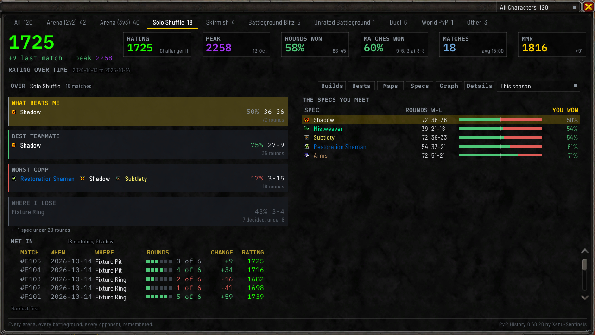
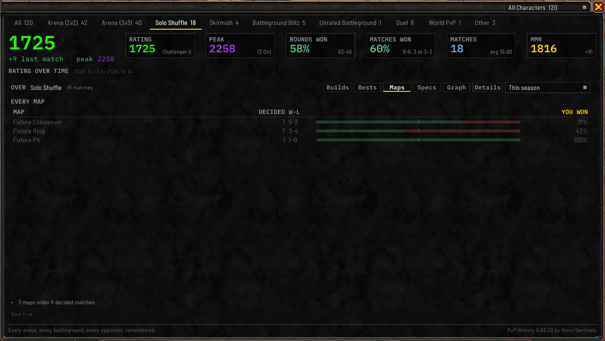

# Ask

The lower half of the **Stats** tab answers four questions about what you have played, so you don't
have to read the list yourself. The cards stand at the left, and the card you have lit fills the right
with the table behind its answer. **WORST COMP** draws the [composition table](Compositions).

Pick a tab, then click **Stats** under the window. A tab with nothing the questions can rank, such as
**All**, shows its own figures there instead: see [The All tab](Summary-and-Rating-Graph#the-all-tab).

## What the answers are read over

The line above the cards reads **OVER**, then the kind of match, then how many matches that comes to.

The time range is the same setting as the
[dropdown beside **Graph** and **Details**](Summary-and-Rating-Graph#choosing-a-time-range): change it
in either place and both follow. The [character dropdown](Match-History-Window#showing-one-character)
in the title bar narrows the answers too.

## The four questions

Each question is a card, with an edge down its left side in your win or loss colour. The question is its
heading, and the answer is under it: a spec as its icon and its name in its class colour, a team
composition as its specs side by side, or a map. Under the answer is your win rate in colour with your
record beside it, and the line under them says how many rounds or matches it was taken over. Click a card
to see the whole table behind it on the right.

| Question | What it answers |
| --- | --- |
| **WHAT BEATS ME** | The opponent spec you win least against |
| **BEST TEAMMATE** | The teammate spec you win most with |
| **WORST COMP** | The team composition you do worst against. Its table is the one described under [Compositions](Compositions) |
| **WHERE I LOSE** | The map you lose on most |

**WHAT BEATS ME** and **BEST TEAMMATE** answer on Solo Shuffle, the one format where a spec can be
counted on each side round by round.

### Only rows with enough games are ranked

A row is ranked once it has enough games behind it to mean something:

- a spec, once it's been in **20 rounds**
- a team composition, once you've met it **10 times**, each Solo Shuffle round or arena match counting
  once
- a map, once it's had **8 decided matches**

A line under each table counts the rows that haven't reached it yet, such as `3 specs under 20 rounds`.
`/pvph ask under on` lists them after the ranked rows, greyed, until you log out or reload.

**WHERE I LOSE** names a map only where at least two maps have enough matches, and the one it names is
a map you've lost more than you've won.

**A card with nothing ranked yet** shows the row closest to the answer, faint, with how far it is from
the bar, such as `7 decided, under 8`. A card with no row at all reads `none yet`.

## The answer table

| Column | What it shows |
| --- | --- |
| **SPEC** or **MAP** | The spec or the map |
| **ROUNDS** or **DECIDED** | How many rounds, or how many matches with a result |
| **W-L** | Your wins and losses, with a bar beside them in your win and loss colours |
| **YOU WON** | Your win rate, in the win colour above half and the loss colour under it |

**YOU WON** is your own win rate over those games, not that spec's.

**Click a column heading to sort by it**, and click it again to turn the order around. Each question
starts with its answer at the top. A sort lasts until you log out or reload. `/pvph ask sort` does the same from chat; see
[Commands](Commands).

## The matches behind a row

Click a row to list the matches it was counted over, under **MET IN** (or **PLAYED ON** for a map): how
many there were, then one line per match. Under a spec, the matches have their own headings, **MATCH**,
**WHEN**, **WHERE**, **ROUNDS**, **CHANGE** and **RATING**: the date, the map beside the six round
squares and the rounds you won, such as `4 of 6`, your rating change in colour and your rating in its
tier colour. Click a match to open its window, and you stay on the
question you asked. Click the row again to close the list. Changing the question, the tab or the time
range closes it too. `/pvph ask open` and a row number does the same from chat, and bare closes it.

## The Maps view

**Maps**, in the row of controls beside **Graph**, lists every map you've played on the tab in place of
the cards: **MAP**, **DECIDED**, **W-L** and **YOU WON**, best first. A map with fewer than 8 decided
matches sorts after the others, greyed, and a map with no decided match at all has a dash for its rate.
Click a heading to sort by it. While it's showing, **Maps** is the one control lit in that row. Click
**Maps** again to go back to the cards. Your choice is remembered after a reload, and
`/pvph show <tab> stats maps` opens it for the session. On **Duel**, **World PvP** and **Other**,
**Maps** shows only where the tab holds two maps or more.

## The Builds view

**Builds**, at the left of the same row, lists each talent build you played on the tab in place of the
cards, under **YOUR BUILDS**: **BUILD**, named by its saved loadout and hero tree, then **MATCHES**,
**W-L** and **YOU WON**, the build you played most first. Where the tab holds more than one of your specs,
each build names its spec too. Click a build to list the matches you played it in, under
**PLAYED WITH**, and click a match to open its window. Matches saved before the addon kept builds are
counted in one line under the table. Click **Builds** again to go back to the cards, and
`/pvph show <tab> stats builds` opens it for the session. **Duel** and **World PvP** don't offer it.

## The Bests view

**Bests**, beside **Builds**, lists your best match for each spec you played on the tab, under
**YOUR BESTS, BY SPEC**: top **DAMAGE**, top **HEALING**, **PEAK RATING**, **PEAK MMR** and
**FASTEST WIN**. The rating columns show only where the tab has rated matches. Click a spec to list the
matches that hold its bests, under **BESTS SET IN**, and click a match to open its window. Click
**Bests** again to go back to the cards, and `/pvph show <tab> stats bests` opens it for the session.
`/pvph bests` prints the same table in chat, one line per spec, and a format word picks the tab, such as
`/pvph bests shuffle`. **Duel** and **World PvP** don't offer it.

After a match that beats one of your bests for that spec, a line in chat names it, such as
`new best: damage 4.2M`. It waits until you have five earlier matches of that format on that spec.

## When a question has nothing to say

The table is empty and the note under it reads `none yet`. If an answer couldn't be worked out at all,
it reads `this couldn't be read: try /reload`. `/pvph ask` says in chat why a question has nothing.

## In chat

`/pvph ask` prints the same **OVER** line and one line per question, with its answer or a note that it
has none. Add a format word, such as `/pvph ask shuffle`, to ask about one format without opening the
window. The format words are on the [Commands](Commands) page.
