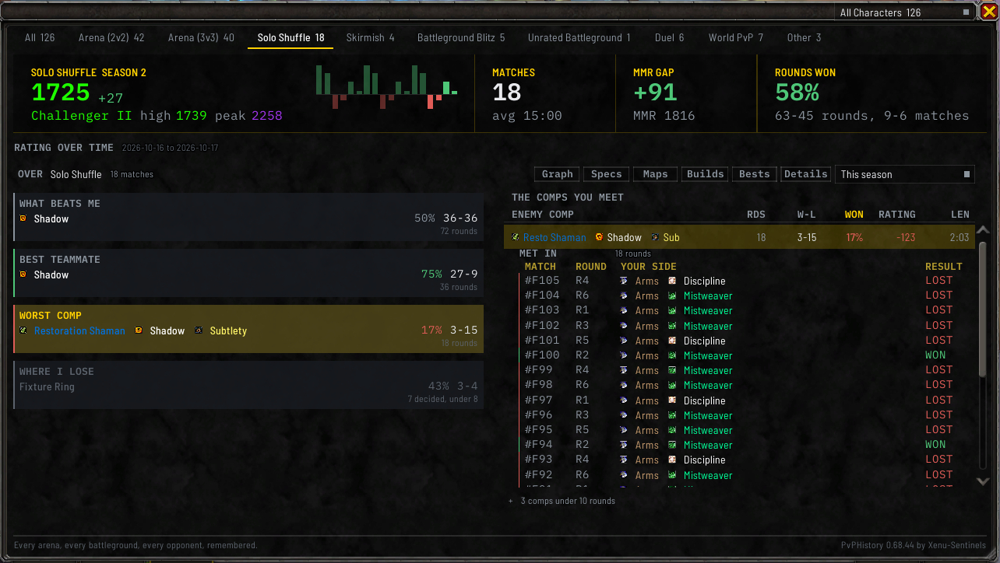

# Compositions

The composition table shows which team compositions you've faced and how you did against each. Pick an
arena tab, **Skirmish** or Solo Shuffle, click **Stats** under the window, and light the **WORST COMP**
card (see [Ask](Ask)). Tabs without team compositions don't offer the card, and **Other** shows it with
nothing in it.

For the specs you do well with and against, one at a time, see [Specs](Specs).

## What counts as one game

- **In arena**, each match counts once: the team you faced.
- **In Solo Shuffle**, each round counts once: the three players on the other side that round.

A composition is **ranked** once you have met it ten times. The line under the table counts the ones
with too few, such as `3 comps under 10 rounds` on Solo Shuffle.

A drawn arena match counts as a game you met the comp in, and its record names it after the wins and
losses, such as `2-3, 1 drawn`. The win rate and the ten that ranking needs count decided games only, so
in arena the line where ranking stops reads `UNDER 10 DECIDED`, and a comp you drew every game against is
counted under the table rather than ranked.

A Solo Shuffle round nobody could work out a winner for is left out. Rounds you [filled in yourself](Solo-Shuffle#filling-in-a-missing-round) aren't used here.

Bot teams from practice modes are never counted.

## The composition table

Under **THE COMPS YOU MEET**, each row is a team you've faced:

| Column | What it shows |
| --- | --- |
| **ENEMY COMP** | The specs side by side, each as its icon and its name in its class color. Where the full names don't fit, every row uses short names, such as Resto Shaman, Shadow and Sub, and where those don't fit either, icons alone. Rest the pointer on a row to see every spec named in full |
| **RDS**, or **GAMES** in arena | How many games you've met it in |
| **W-L** | Your wins and losses against it |
| **WON** | Your win rate against it |
| **RATING** | The rating you gained or lost against it, where the game reported a change you can tie to that round. Blank where it reported none |
| **LEN** | How long those games took |

The hardest ones are at the top: the table is sorted on **WON**, and the sorted heading is drawn in
gold. Click **RDS**, **GAMES** or **WON** to sort on it.

Click a row to see the games behind it under that row, under **MET IN**: a grid of **MATCH**,
**YOUR SIDE** and **RESULT**, with a **ROUND** column where the games have rounds, **WON** in green and
**LOST** in red, each line opening its match window. A second click on the row puts the list away. In
Solo Shuffle each line names the round and the specs of the two players who were on your team, which tells you whether it's the composition beating you or a
particular partner you keep losing with. Clicking a row never narrows the
[match list](Match-History-Window#the-match-list).

## Trios and pairs

On Solo Shuffle, **Arena**, **3v3** and the unrated arena tab, **Trios** and **Pairs** sit at the right of **THE
COMPS YOU MEET**. **Trios**, the default, ranks whole enemy teams as above. **Pairs** ranks the enemy
healer with each of the other specs, so a team you met once or twice still adds to pairs you meet
often, and more of a season reaches the round floor:

- Each round, or each match in arena, adds to every pair holding a healer: up to two pairs where the other
  side had one healer, up to three where it had two. A side with no healer adds to every one of its pairs,
  and two players of one spec on a side count as one pair.
- The first column reads **ENEMY PAIR**, each row naming the healer first, then the other spec after a
  plus, such as `Disc + Arms`.
- The line under the table counts pairs, such as `41 pairs under 10 rounds`.
- Opening a pair lists the rounds it was met in, each naming the whole enemy team of that round.

A round can count toward several pairs, so the pairs' rounds add up to more than you played. Each tab
keeps its own choice, through closing the window and logging out, and clicking the **WORST COMP** card
puts that tab back on **Trios**. The [Ask](Ask) cards always read whole teams. 2v2 has no switch, its
enemy side already being a pair. Rest the pointer on the switch to see how a round is counted.

## Narrowing it down

The [time range dropdown](Summary-and-Rating-Graph#choosing-a-time-range) and the
[character dropdown](Match-History-Window#showing-one-character) both apply here.

`/pvph comps` prints the same ranking in chat. Add a format word (such as `shuffle` or `arena2`) to pick
the format, and a row number to see the games behind that row. `/pvph comps pairs` prints the pairs
and shows **Pairs** in the window for the rest of the session, or until you type `/pvph comps trios`,
without changing the choice the switch keeps.
