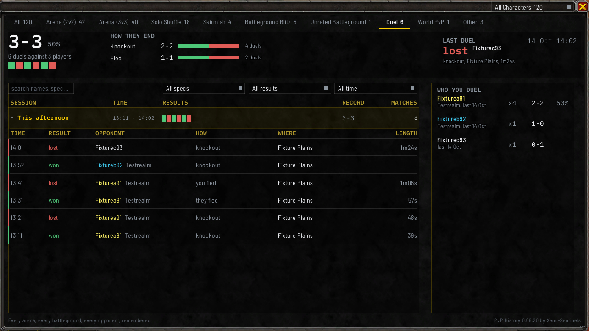
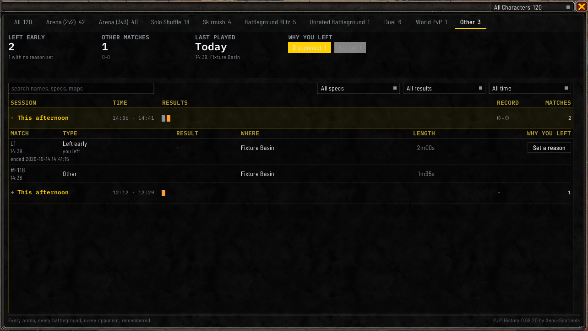

# Duels and unfinished matches

## Duels

A finished duel is saved with who you dueled and whether it ended in a knockout or with someone running
away. Duels have their own **Duel** tab in the [match history window](Match-History-Window), and your
opponents appear in the [players window](Players-and-Notes).

The game doesn't keep any record of duels, so the addon takes the result from the message the game prints
in chat when a duel ends. A duel that ends without that message isn't saved.

### The Duel tab

Across the top of the **Duel** tab are your record and win rate, how many duels you've had against how
many players, and your last ten results as squares. **HOW THEY END** splits your duels into knockouts
and runs, saying whether they fled or you did, and **LAST DUEL** shows your newest one.

The list's columns are **TIME**, **RESULT**, **OPPONENT**, **HOW**, **WHERE** and **LENGTH**. The
opponent's name is in their class color where the addon knows who they were. **LENGTH** is blank where
the addon didn't see the duel being asked for.

**WHO YOU DUEL**, beside the list, ranks the people you've dueled by how often, with your wins and
losses, your win rate once you've dueled them three times, their realm and the last time you met. Click
one to open their window.

`/pvph duel off` stops recording duels and `/pvph duel on` starts again. `/pvph duel` on its own says
whether it's recording.

## Matches you left early

Leaving a match before it ends, whether on purpose, by disconnecting, or because the game closed, still
gets saved, so a lost rating doesn't simply disappear from your history.

These show up under the **Other** tab, numbered `L1`, `L2` and so on. You can also type `/pvph left` to
list them in chat, or `/pvph incomplete` to open the window on that tab.

**They carry less than a finished match**: when and where it was, how long you were in it, how many rounds
had been played, and whether it was rated. The game doesn't reveal the list of players until a match
finishes, so the addon can't save it. The format is saved where the addon could read it during the
match. A short entry here is what every match left early looks like, not a sign of a problem.

### The Other tab

Across the top are **LEFT EARLY**, with how many have no reason yet; **OTHER MATCHES**, the matches the
addon couldn't file under a format, with their wins and losses; **LAST PLAYED**; and **WHY YOU LEFT**,
with a count for each reason and **Not set** for the ones you haven't given one.

The list's columns are **MATCH**, **TYPE**, **RESULT**, **WHERE**, **LENGTH** and **WHY YOU LEFT**. Under
**TYPE**, a match you left reads `you left`, or `found at next login` where the game closed before the
addon could see you leave.

### Saying why you left

The game can't tell a disconnect from a crash or from you closing it on purpose, so you can record the
reason yourself. Click **Set a reason** under **WHY YOU LEFT** on the entry's row and pick one. The
button then reads the reason you picked, and clicking it again lets you change it.

- **Disconnect**
- **Crash**
- **Game closed**
- **Chose to leave**
- **Kicked**

## Filling in a missing detail

If a match is missing a detail the addon couldn't read, such as the result, `/pvph edit` followed by the
match number lets you fill it in. A missing result can also be entered with the **win**, **loss** and
**draw** buttons at the bottom of the match's window. Anything you enter is marked as entered by hand,
and it never replaces something the addon recorded itself. A World PvP outing takes no result, since
it has no winner.
