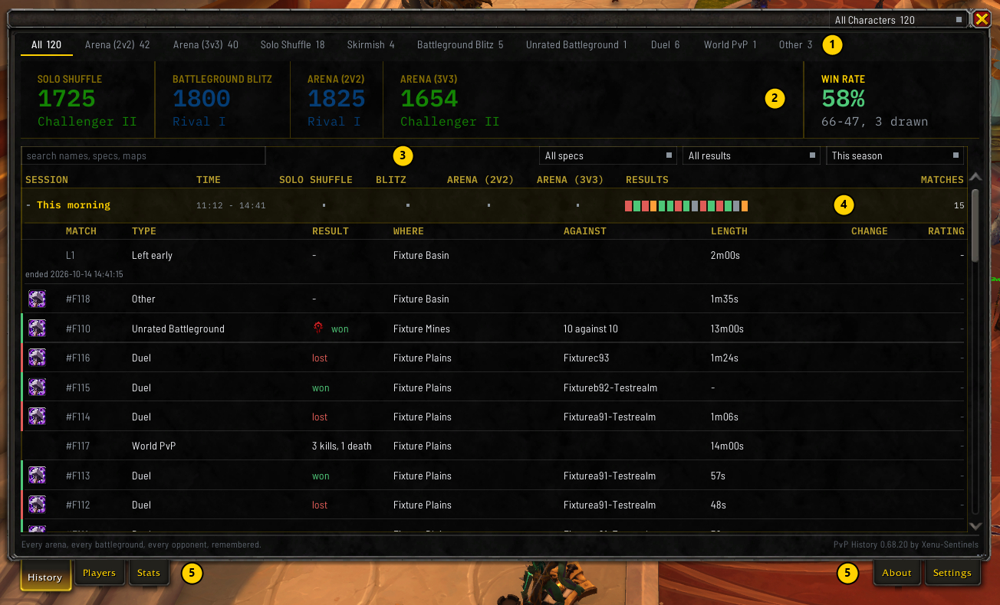

# Getting started

This page takes you from nothing to your first saved match. It takes about five minutes, plus one match.

## 1. Install it

1. Close the game.
2. On the [releases page](https://github.com/xenulive/wow-pvp-history/releases), download the zip under
   the newest release.
3. Open your World of Warcraft folder, then `_retail_` (`_forever_` on the Forever client), then
   `Interface`, then `AddOns`.
4. Unzip the download into `AddOns`. The zip holds one folder, `WowPvpHistory`.

Or install it through the CurseForge app from [its CurseForge page](https://www.curseforge.com/wow/addons/wow-pvp-history),
or through the Wago app from [its Wago page](https://addons.wago.io/addons/wow-pvp-history). Both carry the
same zip and keep the addon up to date. Every full release is also on
[its WoWInterface page](https://www.wowinterface.com/downloads/info27266-PVPHistory.html), as the same zip.

**Check the folder before you start the game.** You should now have
`_retail_\Interface\AddOns\WowPvpHistory`, or `_forever_\Interface\AddOns\WowPvpHistory` on the Forever
client, and inside it a file called `WowPvpHistory.toc`. If that file
is one folder deeper, such as `AddOns\WowPvpHistory-0.68.21\WowPvpHistory`, move the inner
`WowPvpHistory` folder up into `AddOns`. The game only looks one folder down.

## 2. Start the game and check it loaded

On the character select screen, click **AddOns**. **PvPHistory** should be in the list under the
**PvP** heading, with its box ticked. If it isn't there, go back to the check in step 1.

Log in. There's nothing to set up: the addon starts recording on its own. To be sure it loaded, type
`/pvph status` in chat. It answers with the version.

## 3. Play a match

Any arena, Solo Shuffle, battleground, Blitz or duel counts. Play it to the end, because a match you
leave early is saved with less in it.

When the match ends, the leave button is covered for a few seconds and reads `Saving the match`. That's
the addon reading the scoreboard. It turns to `Saved` and then lets go, and you can leave.

When you're back out of the instance:

- a line in chat says the match was recorded, with a link under it to open the match
- the match opens in its own window by itself

## 4. Open your history

Type `/pvph`, or click the minimap button. This is the [match history window](Match-History-Window).

What you're looking at:

1. **The format tabs**: **All**, then one tab for each kind of match you've played.
2. **Your standing**: your rating and win rate for the tab you're on.
3. **The search row**: a search box and three dropdowns, for the spec, the result and the time range.
4. **The list**: your matches, grouped by when you played them. Click a session to open it, then click
   a match to see everything about it.
5. **The tabs under the window**: **History**, **Players** and **Stats** at the left, and **About** and
   **Settings** at the right.

## 5. Where to go next

- Write down what you thought of a player: [Players and notes](Players-and-Notes)
- See your win rate and rating over time: [Summary and rating graph](Summary-and-Rating-Graph)
- Get told when you meet someone you've played before: [Alerts](Alerts)
- Something doesn't look right: [Troubleshooting](Troubleshooting)
- A word on these pages you don't know: [Words used here](Words-Used-Here)
