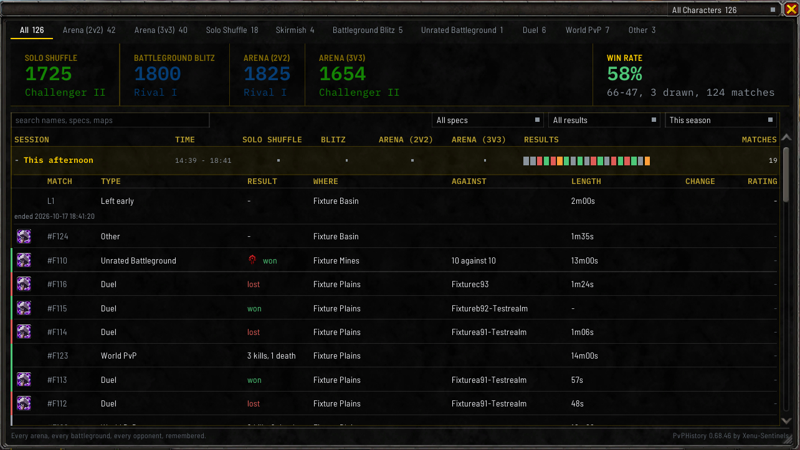
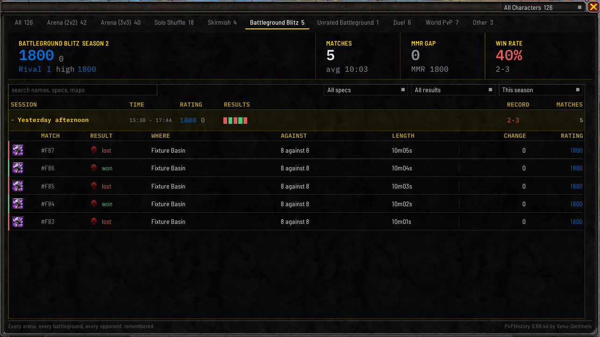
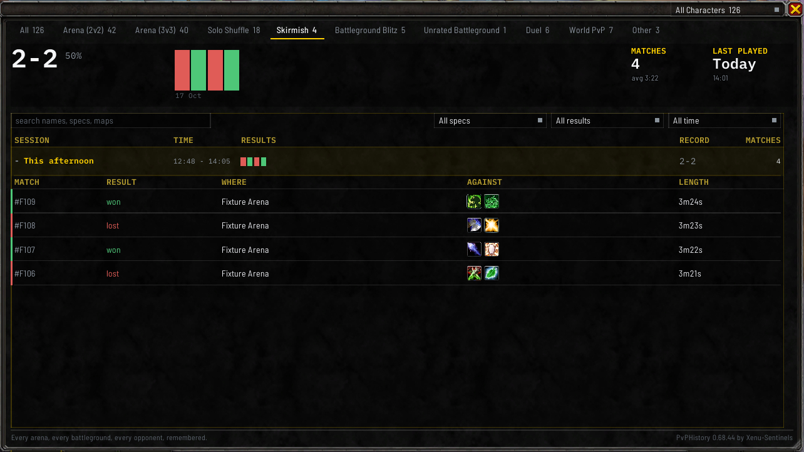
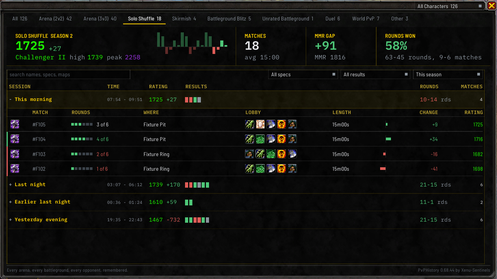
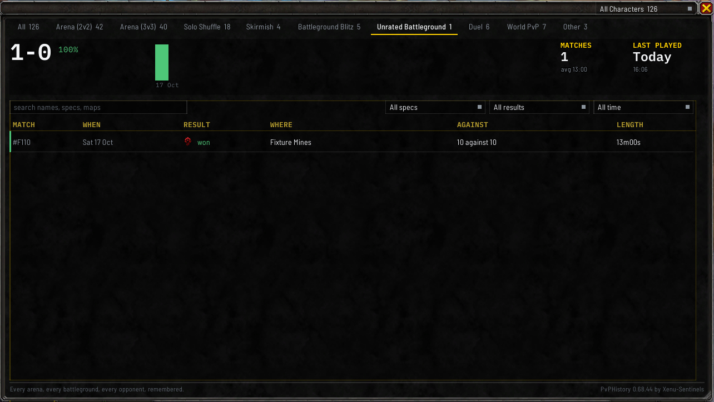
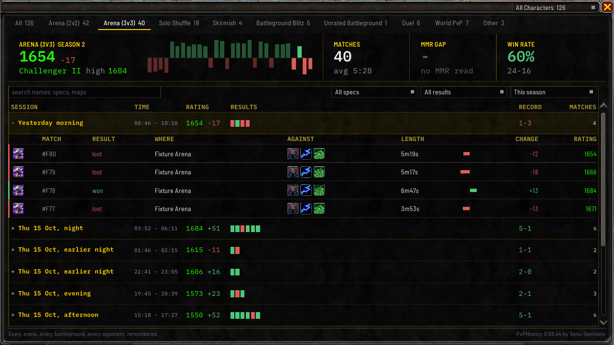
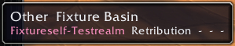
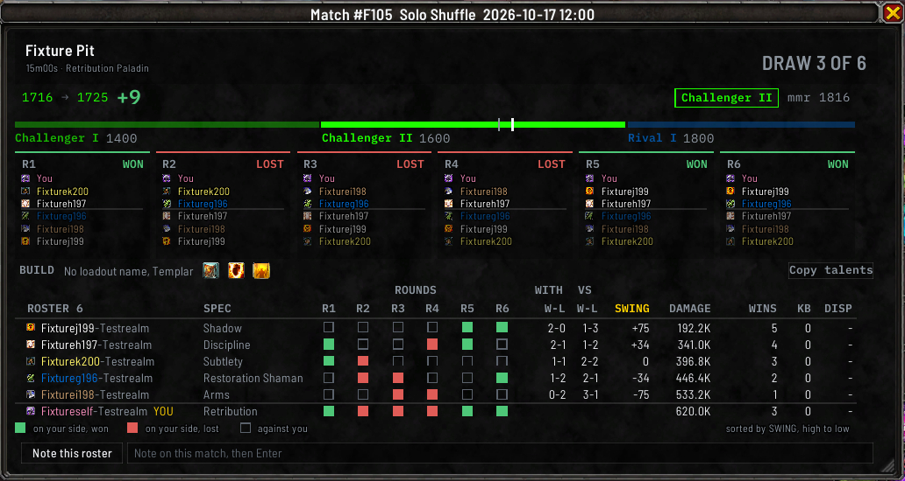
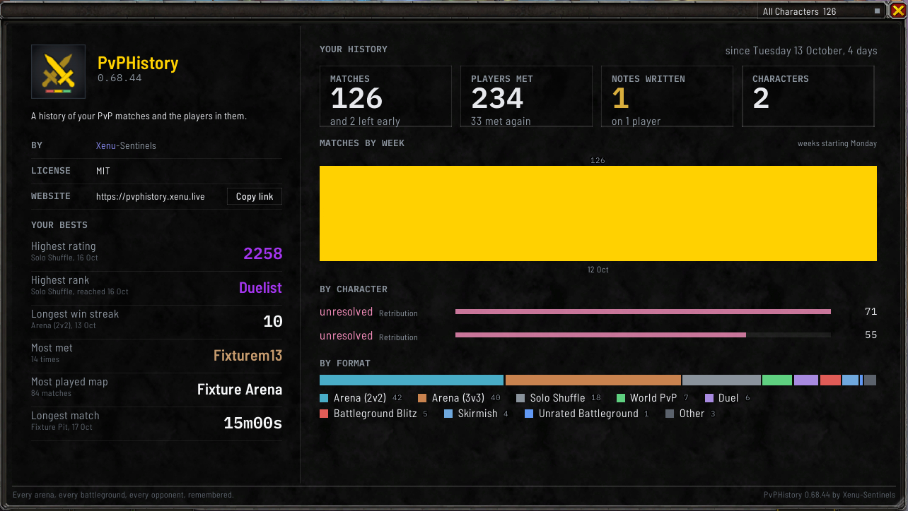
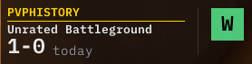

# Match history window

This is the main window. It lists every match you've finished, grouped into the sessions you played
them in, and clicking one opens a window of its own with everything about that match: the result, the
map, how long it took, your rating change, and everyone who played.

Open it with `/pvph`, the minimap button, the addon menu beside the minimap, or a key binding. To jump
straight to one match, type `/pvph show` and the match number.

## The short version

- Click a session to open it, then click a match to see everything about it in its own window.
- The tabs pick which kind of match you see. The search box and the dropdowns beside it narrow the list
  further.
- Click the box at the left of a match row, or `Ctrl`-click the row, to pick up to four matches of one
  format to [compare them side by side](#comparing-matches).
- If the window ends up off the screen, type `/pvph window reset`.

The rest of this page goes through every part of the window.

## The title bar and the foot

The dropdown at the top right shows one character at a time. See below.

The line along the bottom of the window reads the addon's tagline at the left, and its name and version
at the right.

## The tabs under the window

Five tabs hang under the window's bottom edge: **History**, **Players** and **Stats** at the left, and
**About** and **Settings** at the bottom right. The tab you are on is drawn chosen and can't be clicked.

- **History** is the list of your matches, which is most of this page.
- **Players** is the [players window](Players-and-Notes).
- **Stats** holds the figures, the rating graph and the questions the addon answers about what you
  have played. See [Summary and rating graph](Summary-and-Rating-Graph), [Compositions](Compositions),
  [Specs](Specs) and [Ask](Ask).
- **About** is described [below](#about).
- **Settings** is the [settings](Settings-and-Storage). They are a part of this window, so they take
  the size you gave it.

**History** and **Stats** show the same tab, time range and character. **History** and **Players** share
one size and place: drag or resize either and the other follows, and the window opens on **History**.
On **About** and **Settings** the format tabs and the figures are hidden.

`/pvph options` and the **Settings** entry in the minimap button's menu open the settings and, when
they are already showing, close the window. `/pvph about` opens **About**.

## Format tabs

There's a tab for each kind of match you've played, so a tab only appears once you've played that kind.
Each tab shows how many matches it holds.

- **All** is first and shows everything.
- Rated arena and rated Solo Shuffle come next, then their unrated versions, then battlegrounds.
- **Duel** and **World PvP** come after the battlegrounds. See
  [Duels and unfinished matches](Duels-and-Unfinished-Matches) and [World PvP](World-PvP).
- **Other** is last. Matches you left early end up here.

The window opens on whichever tab you used last. Type `/pvph tab all` to have it always open on **All**,
or `/pvph tab remember` to go back.

## Showing one character

If you play PvP on more than one character, the dropdown in the title bar lets you show just one of
them. It narrows everything in the window: the tabs, the figures, the graph, the list and the
compositions. **All Characters** shows everyone.

Each character in the dropdown shows how many matches it has. A character appears by name once you've
logged into it with the addon installed. Until then it's listed as **unresolved**, with its match
count.

A few matches you left early before version 0.2.1 can't be tied to a character, so they only count
toward **All Characters**.

The players window isn't affected by this dropdown.

## Your standing, above the list

A strip across the top of **History** shows where you stand on the tab you are on. **Stats** opens on
the same strip.

- **On All**, each rated format you've played gets a block: its name, your rating in the color of
  your PvP tier, the change from your newest session beside it (nothing when it didn't move), and the tier's name under it. **WIN
  RATE** stands at the right, with your wins and losses under it, then your average match length.
  Where the blocks don't all fit, the ones you are
  Unranked in give way first.
- **On a rated tab**, one block shows your rating, its tier and your season high, with your peak
  beside it where it is above your season high. Beside it, your newest 30 matches stand as bars above and below a
  center line, then **MATCHES** with your average match length, **MMR GAP** with how far your
  matchmaking rating is from your rating and your matchmaking rating under it, such as `MMR 1812`
  (a dash over `no MMR read` where the game gave none), and at the right **WIN RATE**, or **ROUNDS WON** on Solo
  Shuffle with your rounds and your matches under it, such as `63-45 rounds, 9-6 matches`. In a narrow
  window **MMR GAP** gives way first, then **MATCHES**. A bar is never narrower than 3 pixels, so
  where they don't all fit the oldest are left out.
- **On Duel and Other**, the strip has its own figures, described on
  [Duels and unfinished matches](Duels-and-Unfinished-Matches), and **World PvP**'s are described on
  [World PvP](World-PvP#the-world-pvp-tab).
- **On a tab with no rating**, it shows your record and win rate and a square for each match, then
  **MATCHES** with your average match length and your matchmaking rating where one was read, and
  **LAST PLAYED**.

A win rate reads green above 50%, red below and gray at exactly 50%. A drawn match is left out of both
the count and the rate, and named apart, such as `66-47, 3 drawn`.

## The match list

Under the strip, your matches are grouped into sessions: matches played within an hour of each other
belong to one session. Each session is one line under a fixed row of headings.

- **SESSION** names the day and the part of it, such as `Sat 24 Oct, evening`. The parts are morning,
  afternoon, evening and night, and a session after midnight counts as the night of the day before. A
  second session in the same part of a day reads `Sat 24 Oct, earlier evening`. In a narrow window the
  day drops its weekday, such as `24 Oct, evening`, and keeps its part.
- **TIME** is when it started and ended. In a narrow window it moves under the session's name.
- **On All**, a column for each rated format you played shows your closing rating in its tier color
  and the session's change, or the rating alone when it didn't move. A dot means you didn't play that format in the session. Rest the pointer
  on a cell to see where your rating went from and to, and how many matches that was. Past four
  formats, the last column reads `+2` and so on, and its hover lists the formats it holds.
- **On a format tab**, **RATING** shows the same for that format, and **ROUNDS** on Solo Shuffle or
  **RECORD** elsewhere adds up the session. World PvP's sessions show your kills and deaths instead;
  see [World PvP](World-PvP#the-world-pvp-tab).
- **RESULTS** has a tick for each match, oldest first, in your win or loss color, gray for a match
  with no winner, and amber for a match you left early. A session of more than 20 matches shows the
  newest 20 and a count of the rest, such as `+6`.
- **MMR** shows your matchmaking rating at the end of the session and how far it moved, such as
  `2019 -112`; a session where it did not move shows the MMR alone. On **All**, a session across
  several rated formats shows how many, such as `2 formats`, since each format has its own MMR. Rest
  the pointer on it to see each format's MMR going in and coming out. A dash means no MMR was read
  for that session's rated matches, and the cell is empty on a session with no rated match.
- **MATCHES** counts them.

**Click a session to open it**, and click it again to fold it. The newest session starts open and the
older ones folded, and a session you open or fold stays that way after a reload. An open session lists
its matches under it, with a row of column headings. When you scroll an open session's matches up past
the top of the list, its line stays pinned there.

Where every session on a tab holds only one match, the list skips the sessions and lists the matches
under one row of headings, with **WHEN** saying the day.

**A season line stands between two seasons**, so you can see where one ended.

### Each match

Each match is one line. Which columns show depends on the tab:

- a small square for the spec you played
- **MATCH**, the match number. A match you left early is numbered `L1`, `L2` and so on.
- **FORMAT**, on **All** when the list holds more than one kind of match
- **RESULT**, which reads `won`, `lost` or `draw`, with your faction's crest in front where the match
  had sides. A result you entered by hand reads `won*`, `lost*` or `draw*`, and once a Solo Shuffle's rounds decide the match they win and your entry is kept as set aside. A Solo Shuffle shows its six
  rounds as small marks under **ROUNDS** instead.
- **WHERE**, the map
- **AGAINST**, a small mark for each opponent in their class color, or **LOBBY** on Solo Shuffle for
  the other five players
- **LENGTH**
- **CHANGE**, your rating change as a small bar and its figure, and **RATING**, your rating after the
  match in its tier color. A match that carries a rating but no rating change shows a dash under
  **RATING**.
- **MMR**, after **RATING** on the rated Blitz, rated Solo Shuffle, rated arena and **All** tabs: your
  team's MMR in green against the enemy team's in red, such as `1843 v 1910`. Each is the team's MMR as
  the game reports it, or where it gave none, the average of the players on that side who had one. A
  side with none reads `-`. On a Solo Shuffle it is worked out round by round from who was on your team.
  Arena shows it on matches recorded from version 0.69.4, since the game gives no MMR for the players
  there and the team figure can only be read during the match.

A Solo Shuffle you won three rounds of reads `3 of 6`. The **Skirmish** tab, and any tab where nothing
moves a rating, has no **CHANGE** or **RATING** column.

The columns spread across the whole width of the window. In a narrow window a long value, such as a
long map name, is cut short; the column headings never are.

The time range you pick (see [Summary and rating graph](Summary-and-Rating-Graph)) also decides which
matches the list shows. An empty list reads `No matches yet.` before you've played anything, and
`No matches.` when the tab or the time range leaves nothing to show.

### Searching and filtering

Four controls sit at the head of the list on every tab but **World PvP**, which has its own (see
[World PvP](World-PvP#the-world-pvp-tab)): a search box at the left, and three dropdowns
at the right, for the spec, the result and the time range, in that order.

**The search box** narrows the list to the matches whose players, specs or map carry every term you
type. Separate terms with commas. A spec is read together with its class, so `Frost Mage` finds a Frost
Mage and not a Frost Death Knight. Start a term with `-` or `!` to leave out the matches that carry it.
Accented letters and Cyrillic match whatever case you type them in. `/pvph search` and some text does
the same from chat, and `/pvph search` alone clears it.

**The spec dropdown** reads **All specs** until you pick one of the specs you played. It lists each
spec you played on the tab you are on, with how many matches that is, the one you played most first.

**The result dropdown** reads **All results** until you pick **Won**, **Lost** or **Even**. **Even**
covers a match with no winner, such as a Solo Shuffle you won three rounds of six.

**The time range dropdown** is the same one as on **Stats**: pick a range in either place and both
follow. See [Choosing a time range](Summary-and-Rating-Graph#choosing-a-time-range).

While a search, a spec or a result narrows the list, a count beside the search box says how many of
the tab's matches are showing, such as `12 of 80 matches`. A filter that leaves nothing says so, such
as `No won matches as Frost Mage.` The figures, the graph
and **Stats** read the whole tab in the time range you picked. Your search and your spec and result
choices last until you log out or reload, and aren't saved; the time range is saved.
`/pvph filter result` with `all`, `won`, `lost` or `even`, and `/pvph filter spec` with a spec or `all`,
set the dropdowns from chat, and `/pvph filter` alone prints both choices and the count.

### The right-click menu

Right-click a match to get a menu of what you can do with it, without opening it first:

- **Open**, which reads **Close** while that match's window is up
- **Write a note**, which opens the match's window with the cursor in its note box
- **Note this roster**, or on a duel **Note this duel**, which opens the
  [players window](Players-and-Notes)
- **Print in chat**
- **Compare**, which picks the match for [comparing](#comparing-matches), or **Remove from compare**
  once it is picked. **Compare** is grayed where the match can't join the ones you picked, and resting
  the pointer on it says why: `Must be the same match type` for a match of another format, or
  `Four is the most` once four are picked.
- **Copy talents**, offered where the match saved the build you played, which opens the talent string
  ready to copy
- **Enter result**, with **win**, **loss** and **draw** under it, offered only where the addon couldn't
  record a result

A Solo Shuffle offers **Enter result** only where its rounds don't settle anything. A World PvP outing
offers **Open**, **Note this outing**, **Print in chat** and **Compare**. A match you left early has its
own menu under **WHY YOU LEFT** instead.

### The tooltip

Hold `Shift` while the pointer is over a match to see it in a tooltip. Its first line is the result,
the format, the map and the rating change. An arena or a Solo Shuffle then lists every player, your
team first, with their spec, damage, healing and dispels, and a Solo Shuffle adds a line for each
round. A battleground shows each team's objective totals and then your own line. Without `Shift` nothing
shows. A duel, a World PvP outing and a match you left early have no tooltip.

## One match, in its own window

Click a match to open it in a window of its own. Its title bar names the match number, the format, and
the date and time it started, such as `Sat 24 Oct 07:01`.

**At the top**, the result leads in large letters: `WON`, `LOST` or `DRAW`, or on a Solo Shuffle the
rounds, such as `WON 4 OF 6`, `LOST, WON 2 OF 6` or `DRAW 3 OF 6`. The map is under it, with how long
the match lasted and the spec you played.

**On a rated match**, your rating going in, an arrow, your rating coming out and the change sit beside
the result: a Solo Shuffle you went into at 1716 and won 9 on reads `1716`, the arrow, `1725` and `+9`.
At the right, a chip names the tier you ended in, in its color, with your matchmaking rating beside it,
and the chip reads `reached` when the match took you into a new tier. In a narrow window your ratings
give way before the result does. Under them, a bar shows the tiers around you with marks at your
rating before and after.

**BUILD**, on the line under that, names the talent loadout and hero tree you played, with an icon for
each PvP talent; rest the pointer on an icon to see its name. The **Copy talents** button at the right
of the line opens the talent string already selected: press Ctrl+C, then paste it into the game's talent import. A
match saved before the addon kept builds has no **BUILD** line, and a build with no saved loadout reads
`No loadout name` in gray.

For a duel, the heading is your opponent. A World PvP outing's window is described on
[World PvP](World-PvP#one-outing-in-its-own-window). A match you left early opens a window titled
`Unfinished #L1` and so on, with what was saved and a box for a note; see
[Duels and unfinished matches](Duels-and-Unfinished-Matches#matches-you-left-early).

**Below that is everyone who played**. A Solo Shuffle shows one table of the players, described on the
[Solo Shuffle](Solo-Shuffle#the-round-table) page, and a card for each round above it. Click a round's card to type a result the addon couldn't record. A battleground, a 2v2, a 3v3 and a Skirmish draw their
teams as described [below](#battlegrounds-and-arenas). Every other match has one row each: the spec's
icon, their name in their class color and realm, spec, role, damage (with a bar comparing it to the top
damage in the match), healing, killing blows under **KB**, and under **DISP** how many dispels they cast,
as the game's own damage meter counted them. **Your team is always listed first.** Your own row is
marked `YOU`, and your group's leader `LEAD`.

A dash under **DISP** means there is no figure for that player, which is every player in a match saved
before version 0.13.0. A duel has no **DISP** column. `/pvph meter` and a match number prints the same
figures in chat, with the reason for each dash, and round by round in a Solo Shuffle.

**Click a player's name to open [their own window](Players-and-Notes#one-player)**, and click it again
to close it. A modified click puts that player into the match list's search instead:

- `Shift`-click adds their name and realm, so the list shows the matches you played with them.
- `Ctrl`-click adds their spec and class, such as `Frost Mage`.
- Add `Alt` to either, or hold it alone, to leave out the matches that carry the term instead.

The list narrows at once, and the history window comes up if it was hidden. Clicking the same term twice
doesn't add it twice, and clicking it with the opposite key flips it. A player with no recorded spec
adds nothing on `Ctrl`.

### Battlegrounds and arenas

**In a battleground**, the window looks like the Solo Shuffle one. Two cards above the players,
**YOUR TEAM** and **THEIR TEAM**, carry each team's objective figures (flags, bases, carts and so on)
and **WON** or **LOST**, so you can see whether you won the objective or the fight. Each card also
shows that team's **MMR** at the right, as the game reports it or the average of its players who had
one. A rated arena match recorded from version 0.69.4 shows these cards too, carrying each team's MMR.

**In a battleground, a 2v2, a 3v3 or a Skirmish**, each team's heading in the roster carries its damage
and healing totals, its MMR where the game gave one, and **WON** or **LOST**. Every player's row has a spec icon, their name in their
class color, an edge in their team's color, their own objective figures in a battleground, their
damage and their healing each with a bar in their team's color, **KB** and **DISP**. Under the table, a
legend shows your team's color and theirs, and a line at the right says which order the roster is in,
such as `sorted by DAMAGE in each team, high to low`. A practice bot's row stays dim and has no icon.

### Sorting the players

Click **DAMAGE**, **HEALING**, **KB** or **DISP** over the roster, or an objective column such as
**CAPS** where the map has one, to sort each team on it, highest first. Click the same heading again to
turn it around. Click the heading over the names to sort by name, and again to turn that around. The
sorted heading is drawn in gold.

Your team stays on top, and each team is sorted on its own. A player with no figure in the sorted column
goes to the bottom of their team whichever way it runs.

A battleground, a 2v2, a 3v3 and a Skirmish open sorted by **DAMAGE**, and every other match by name. The order you pick holds for
every match window you open until you log out or reload. `/pvph scoreboard sort` with `name`, `damage`,
`healing`, `kb`, `dispels` or `objective`, and `up` or `down`, sets it from chat, and `/pvph scoreboard`
alone says which order each table is in. A Solo Shuffle's table sorts the same way, and keeps the order you pick after a reload and a logout; see
[Solo Shuffle](Solo-Shuffle#the-round-table).

**If one team was bots**, as in some practice modes, its heading says how many were bots. Their role is
left blank, because the game reports a made-up one for bots. Bot teams are never counted in your
[compositions](Compositions).

**At the bottom**, always in the same place, is a box for a note on the match, which reads
`Note on this match, then Enter` until you type in it. A note you are part way through typing stays
while the window redraws, and Escape puts back the note you had. If you close the window without pressing
Enter, what you typed is dropped and the window shows the saved note when you open it again. To remove a
note, empty the box and press Enter. Beside it, **Note this roster** opens
the [players window](Players-and-Notes) on everyone who played. On a duel it reads **Note this duel**,
with the box reading `Note on this duel, then Enter`, and on a World PvP outing it reads
**Note this outing** and puts the cursor in the box. If the addon couldn't record the result, the **win**, **loss** and **draw** buttons on the same
line let you enter it. Printed in chat, a result you entered is marked as entered by hand.

Typing `/pvph` followed by a match number prints the same match in chat.

### After a match

When you leave a match the addon has just saved, its window opens by itself once you are out of the
instance and out of combat. A duel, a match you left early and a match that wasn't saved open nothing. If
two matches were saved before you got out, only the newer one opens. Turn it off with **Open the match
window** in the [settings](Settings-and-Storage), or `/pvph aftermatch off`; `/pvph aftermatch`
alone says whether it's on and whether a match is waiting.

### Making a match window bigger

Drag the grip in a match window's bottom right corner to make it wider and taller. Wider shows long
player names whole and spreads the table across the room, and taller shows more of a big
battleground's roster before it scrolls.

Every match window opens at the size you last dragged one to, and a short match still opens only as
tall as it needs. `/pvph window size match` with a width and a height sizes your newest match window
until you log out or reload, without changing the size the next one opens at.

### Several at once

You can have several match windows open. A match window opens where you last left one, or in the
middle of the screen the first time, and each new one opens a step down and to the right of the one
before. Moving the main window leaves the match windows where they are. Drag a match window and the
next one opens where you put it.

**Clicking a match a second time closes its window**, however you opened it: its row in the list, a
match listed under **Stats**, `/pvph show` and the match number, or a match in
a player's list of encounters. The rows of the matches you have open are marked in the list.
`/pvph show last` opens your newest match, and `/pvph show last` with a [format word](Commands#format-words)
opens your newest match of that format. **The link in chat after a match is the exception**: it opens
the window or brings it to the front, and never closes it.

Closing the main window closes every match and player window with it. To keep them open when you close
the list, turn off **Close match and player windows with the main window** on the **General** page of
the [settings](Settings-and-Storage), or type `/pvph closeall off`. Press Escape to close the list and
every match window at once, or type `/pvph window close` to close every match and player window and
leave the list up.

## Comparing matches

You can set up to four matches of one format side by side.

**Picking them.** Click the box at the left of a match row, hold `Ctrl` and click anywhere on the row,
or right-click it and choose **Compare**. Before anything is picked, the empty box shows while the
pointer is over a row that can be picked; clicking it picks the match and opens no match window. A
picked match shows a gold check box in a space of its own at the left of its row, before the spec icon,
and nothing else in the row moves when a box shows. Click the gold box again, `Ctrl`-click the row, or
choose **Remove from compare**, to take it out.

Once you've picked one, the others you pick have to be the same format, and four is the most. From the
first pick, every match row shows its box: an empty one on each match that can join, and a faint one on
each that can't. Resting the pointer on a faint box says why, `Must be the same match type` or `Four is
the most`, and clicking it does nothing. Its **Compare** entry in the right-click menu is grayed with
the same reason.

While at least one match is picked, a bar under the list says how many and of which format, such as `1 Solo Shuffle picked` or
`3 Solo Shuffles picked`, with
**Clear**, which takes them all out, and **Compare 2**, which opens the Compare window. **Compare** needs
two picked matches; with one, resting the pointer on it says to pick one more. Changing the tab, the
search or a filter keeps your picks, even ones the list now hides. Closing the main window clears them
and closes the Compare window.

### The Compare window

The window's title names the matches, such as `Compare 3 Solo Shuffles`. Each match is a column, headed
by a card edged in your win or loss color. Down its left the card shows the match number, the map and
the day with the time, such as `Mon 19 Oct 08:35`. Down its right it shows **WON**, **LOST** or **DRAW** in
large letters, then the score on a Solo Shuffle, such as `4-2`, and the rating change on a rated format.
**The leftmost match is the base**, marked **BASE** on its card under a faint gold outline, and every
other column is set against it. Rest the pointer on **BASE** to see what the `+N` figures mean.

- **Drag a match's card to the left edge**, over the base card, to make it the base.
- **Click the x at the top right of a card** to take that match out. The base has no x.

Under the cards are two tabs: **Figures**, and **Rounds and lobby** on a Solo Shuffle or **Lobby** on
any other match type. The open tab is gold and underlined. A duel and a World PvP outing have only the
figures, with no tabs. The window opens on **Figures**, and switching tabs keeps its size.

#### Figures

The rows stand under two headings, and a row only shows where at least one match has a figure for it:

- **RESULT**: **Rounds won** on a Solo Shuffle, then **Rating change**, **Rating after** and **MMR** on a
  rated format, and **Length**.
- **YOU**: **Build**, then **Damage**, **Healing** and **Killing blows**, and each objective you scored
  on a battleground or Blitz.

A duel and a World PvP outing have no **Damage**, **Healing** or **Killing blows** rows. The base's
column is faintly tinted. A match with no figure for a row, such as one where the game gave no rating,
shows a dash there, and nothing is set against the base on that row.

Beside each figure in a column other than the base, its difference from the base follows right after
it, such as `4 of 6 +1`; a figure equal to the base's shows nothing after it. On the rows where higher
is better (**Rounds won**, **Rating change**, **Damage**, **Healing**, **Killing blows** and each
objective), the difference sits on a small green chip where it is higher and a red one where it is
lower, and the highest figure is gold with a gold edge on its left, every one of them where two tie.
**Rating after**, **MMR** and **Length** have no gold, and their differences are gray with no chip. Two
lengths are only compared where the addon started recording both at the same point in the match.

**Build** and **Length** fold into one line under the last heading where every match reads the same,
such as `SAME IN ALL 3  Length 10:00 · Build Arena`. A row where one match has no figure stays a row.

#### Rounds and lobby, and Lobby

On a Solo Shuffle each match has a line of six round cards, one per round: `R1` to `R6`, **W** or
**L** in the win or loss color under a colored top edge, and the spec icons of the two players on your
side that round. A round with no known winner shows a gray `-`.

Under the rounds, a table lists every spec you met in any of the matches, the specs met in the most
matches first, with a column for each match:

- On a Solo Shuffle each cell is that spec's **SWING** in that match, your win rate with that spec less
  your win rate against it, green where it is above nought and red where it is below. Rest the pointer
  on **SWING** to see what it means. Where one match had two players of that spec, the cell shows the
  one further from nought, and resting the pointer on it lists both. Under the table, **shared with
  base** says how many of each match's specs the base match also met.
- On any other match type each cell counts the players of that spec in that match. A battleground has
  no **shared with base** line.

A cell is blank where that match did not meet the spec. Past twelve specs the table scrolls with the
mouse wheel.

At the bottom, **Add a match** brings up the match list so you can pick another, and **Open each
window** opens each picked match in its own window. Press Escape or click the window's close button to
close it; your picks stay. The window is as tall as the taller of its two tabs. Drag its corner grip to
resize it, and from then on it keeps the size you gave it.

`/pvph compare` and the words after it do the same from chat; see [For developers](For-Developers).

## About

**About** has two halves.

The left half shows the addon's name, version and what it does, who made it under **BY**, the
**LICENSE**, and the **WEBSITE** with **Copy link**, which opens a small box with the address already
selected: press Ctrl+C to copy it. Under them, **YOUR BESTS** lists your highest rating, your highest
rank, your longest win streak, the player you've met most, the map you've played most and your longest
match, each with its format or count and the date.

The right half, under **YOUR HISTORY**, says since when you've played and over how many days, then
counts your **MATCHES** (matches you left early included), **PLAYERS MET**, **NOTES WRITTEN** and
**CHARACTERS**. Under them are your matches by week, by character and by format. **SIZE** shows there
too while **Debug detail on screen** is on.

## The recent results bar

An optional bar at the top of your screen shows how your last matches went. It is off until you turn it
on with **Show the newest results** under **RESULTS ON SCREEN** on the **General** page of the
[settings](Settings-and-Storage), or `/pvph overlay on`.

**PVPHISTORY** heads its left end. Under it is the format of the newest match your logged-in character
has saved, with your rating and today's change, or on an unrated format today's wins and losses. Beside
that is a square for each match of that format, newest at the left, in your win color, your loss color
or gray, marked `W`, `L` or `D`, or on Solo Shuffle with the rounds you won. With no matches saved yet it
reads `No matches yet.`. A World PvP outing never becomes the bar's format, since it has no result.

Hover a square to see that match's date, length, season and rating change, click it to open or close
the match's window, and drag the bar to move it. **Reset all** on the **Size and place of every window**
row of the settings puts it back. The settings also let you pick how many matches it shows (4 to 10, under **Matches shown**), how
dark its background is (**Background**), and whether it hides in combat (**Hide in combat**, on by
default).

`/pvph overlay` alone prints the settings and which matches it would draw. `/pvph overlay count 4` to
`10`, `/pvph overlay opacity 0` to `100` and `/pvph overlay combat on` or `off` change the same
settings.

## Resizing and moving

Drag the grip in the bottom right corner to resize the window, and drag the window itself to move it.
Both are remembered. The grip is the game's own size grabber, the same in every PvPHistory window:
the pointer turns into the resize arrows over it, and it lights up under the pointer and while you
hold it, in the window's text color under **Dark panel** and the game's blue under **Match the game**. The window gets wider and narrower as well as taller and shorter, and everything
in it spreads to the new width.

The window won't shrink past the point where things would start to overlap, and a saved size bigger
than your screen is fitted inside it.

If the window ends up somewhere you can't reach, type `/pvph window reset`, or click **Reset all** on
**Size and place of every window** on the **General** page of the [settings](Settings-and-Storage). Either
one puts every window and the recent results bar back in its place.

## Using it alongside the game's windows

The addon's windows behave like the game's own panels. Click one to bring it to the front, and the
game's windows (like your character sheet) can come in front of it too.

`/pvph show` with a match number closes that match's window if it's already open. `/pvph`,
`/pvph notes` and `/pvph options` open their window, and `/pvph options` also closes the window when the
settings are already showing.
