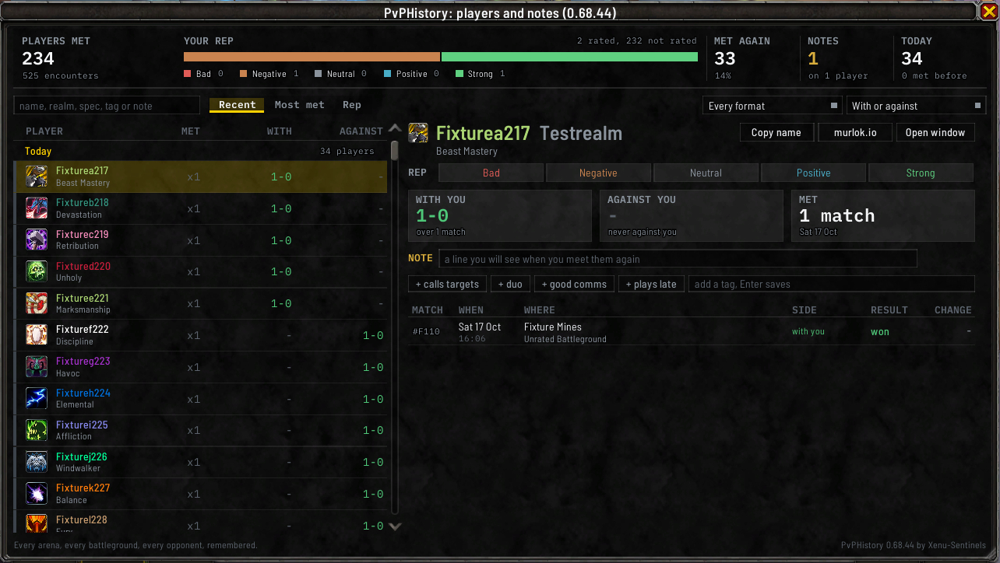
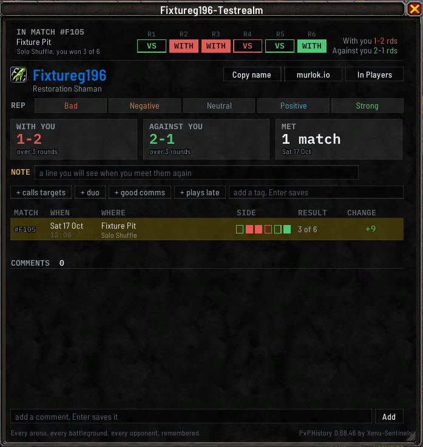

# Players and notes

The addon remembers everyone you've been in a match with, and anyone else you've rated or written
about from the [right-click menu](#from-the-right-click-menu). The players window lists them, and each
player has a window of their own where you can write a note, give a rep, add tags and leave comments,
so the next time you meet them you know what you thought.

Your notes are private. They're only ever shown to you, and the addon never sends anything to chat
channels or other players.

## The short version

- Click any player in a match's window to give them a rep, add a tag or write a note.
- The **Players** tab lists everyone you've played with. Click a name to see your record with them.
- You can also right-click a player in the game and pick **Rate and note**, even someone you've never
  played with.

## Opening the players window

- the **Players** tab under the [match history window](Match-History-Window#the-tabs-under-the-window)
- **Players** in the minimap button's right-click menu
- `/pvph notes`

`/pvph notes last` opens it on just the players from your most recent match, and `/pvph notes #`
followed by a match number opens it on the players from that match.

The players window and the match history window share one size and place, so switching between the
**History** and **Players** tabs keeps the window where it was.

## Writing a note right after a match

When a match is saved, the addon prints one line saying it was recorded, with the number of players in
it and how many of them you have met before, and under it a link reading `Open match #<id> to rate and
note players`. Click the link to open that match's window, then click a player in its list. The link
opens the window or brings it to the front and never closes it. **Chat line after a match**, in the
[settings](Settings-and-Storage), turns these lines off, and `/pvph postgame off` does the same.

You can also:

- click anyone in a match's player list in its [match window](Match-History-Window#one-match-in-its-own-window),
  on any saved match, not just the latest,
- click **Note this roster** at the bottom of a match's window to open the players window on everyone
  from that match at once.

## The list

**Across the top** are your figures: **PLAYERS MET**, with how many encounters that was; **YOUR REP**,
one bar split by how many players you've given each rep, with **Bad**, **Negative**, **Neutral**,
**Positive** and **Strong** under it; **MET AGAIN**, how many you've met more than once; **NOTES**, how
many players you've written on; and the players from your newest session, headed **TODAY** or
**TONIGHT** for a session today. Click a step on the rep bar, or its name, to list only those players,
and click it again to go back.

**The list has one row per player.** Each row has a stripe in the color of the rep you gave them, their
spec's icon, the name in their class color with the realm dimmed, their spec, a mark if you've written a
note, and their first tag. **MET** says how many times you've met them, and **WITH** and **AGAINST** your
record on each side, in your win or loss color, with `-` where there is none. They count only the rounds
the game recorded, so a round you typed in yourself doesn't move them. You and the bots from
practice modes aren't listed.

**Click PLAYER, MET, WITH or AGAINST** to sort the whole list on that column, and click the same heading
again to turn it around. The sorted heading is drawn in gold. **PLAYER** sorts A to Z, and **MET** is the
same order as **Most met**. **WITH** and **AGAINST** put your best record on that side first, counting wins
less losses over rounds and matches together. Players you never met on that side, and players whose
games on that side all ended without a result, go to the bottom whichever way the column runs. A player
you met only in a Solo Shuffle where no round settled still counts as met, and their WITH YOU and
AGAINST YOU cards read `met, no round settled`. A sorted list is headed
with its order, such as `Met most often`, `By name`, `Best with you` or `Worst against you`. Clicking
**Recent**, **Most met** or **Rep** brings back their grouped lists. The order you pick holds until you log
out or reload.

**Above the list**:

- a search box, which finds players by name, realm, spec, class, note or tag
- **Recent**, which groups the list under your newest session, then **This week** and **Earlier**;
  **Most met**; and **Rep**, worst first with players you haven't rated last
- **Every format**, to list only the players you met in one format
- **With or against**, to list only the players you met on one side

A filter you picked shows as a chip you can remove. Opened on one match, the window shows **Show all**
to go back to everyone, and a box reading `tag this whole roster, Enter saves`: type a tag and press
Enter to give it to everyone in that match. Each tag already on the roster shows beside it with how
many players carry it, such as `duo 3  x`; click it to take that tag off all of them. If nothing is left, the window says why, such as
`No listed player matches "zzz".`

**Click a player to see them on the right.** A click picks the player and opens nothing; **Open
window**, at the top right, opens their own window.

`/pvph notes sort`, `rep`, `format`, `side` and `search` set the same controls from chat, until you log
out or reload. See [Commands](Commands).

## One player

The right side of the players window and each player's own window show the same parts:

- **Their name** in their class color, after their spec's icon, or a square in their class color where
  no spec was saved, with their realm and spec.
- **Copy name** and **murlok.io** each open a small box holding the text, already selected: press Ctrl+C
  to copy it. The murlok.io one is the address of their page there, to paste into a browser.
- **REP**: five steps, **Bad**, **Negative**, **Neutral**, **Positive** and **Strong**. Click one to set
  it, and click it again to clear it.
- **WITH YOU**, **AGAINST YOU** and **MET**: your record with them on your side and against you, and how
  many matches you've played with them and when you last met. A Solo Shuffle or a Shuffle Brawl counts
  rounds and every
  other format counts matches, so a record covering both reads like `2-3 rds, 1-0`.
- **NOTE**: type anything and press Enter to keep it. The box counts down what's left. Escape puts back
  the note you had. A note you were typing for one player is cleared when you pick another, so it can
  never be saved on the wrong one.
- The tag row: short labels like `healer` or `duo`. Type one in the box and press Enter, or click one of
  your most used tags, offered as `+ healer` and so on. Each tag the player has reads `healer  x`;
  click it to remove it.
- A table of the matches you've played with them, with **MATCH**, **WHEN**, **WHERE**,
  **SIDE**, **RESULT** and **CHANGE**. A Solo Shuffle's side is six small marks, filled for the rounds
  they were with you. A line under the table counts the encounters not shown. Click one to open that
  match's window, and click it again to close it.

**A player's own window** also has **Comments**: a dated list, newest first. Type one in the box and
press Enter or click **Add**. Each comment has an **x** that removes it. A player can hold fifty
comments.

**Opened from a match**, a player's window starts with a strip for that match: its map and result, six
round boxes marked **WITH** or **VS** on a Solo Shuffle, and your record with and against them in it.
That match is highlighted among the encounters. **In Players** picks the player in the players window,
and clears any filter or search that would have hidden their row.

Drag the grip in the bottom right corner of a player's own window to make it wider and taller. The extra
width goes to the **WHERE** column, and the next player window you open uses the size you left.
`/pvph window size player` with a width and a height sizes your newest one until you log out or reload,
without remembering it.

Every way into one player opens their window: **Open window**, a name in a match's player list, a name
link in chat, and the right-click menu. You can have several open at once. Clicking a player's name in
a match window a second time closes their window; a name link, a menu entry and `/pvph window player`
bring it to the front instead. Escape closes them all. Closing the main window closes them too while
**Close match and player windows with the main window** is on, as it is to start, on the **General** page
of the [settings](Settings-and-Storage); `/pvph closeall on` and `/pvph closeall off` set it.

Anything you write is kept separate from what the addon recorded, so a note never overwrites match data.

## From the right-click menu

Right-click a player (your target or focus frame, a party or raid member, or their name in chat) and the
menu has a section for this addon.

- **The first line** says how many matches you've played with them and against them. Click it to open
  their window. If you've never played with them, it says so.
- **Rate and note** lets you set a rep, or click **Write a note** to open their window with the cursor in
  the note box. It's there for anyone the game can name, including someone you've never played with, such
  as a player in Trade chat. Once you rate or write about them, they show up in your players list by name,
  so you'll know them when you meet them in a match later.

`/pvph menu off` removes this section, and `/pvph menu on` brings it back.

## Duel and World PvP opponents

People you've only dueled appear in the list by name. A player you landed the killing blow on in
[World PvP](World-PvP) is listed too, where the game let the addon read who it was. If you later meet
them in a match, everything you wrote about them carries over.

## From chat

Everything above can also be typed:

- `/pvph note <name> <text>` writes a note, and leaving out the text clears it
- `/pvph rate <name> +2`, `+1`, `0`, `-1` or `-2` sets a rep, from **Strong** down to **Bad**, and
  leaving out the value clears it
- `/pvph tag <name> <tag>` adds tags, and `/pvph untag <name> <tag>` removes them
- `/pvph roster` followed by a match number, then `tag` or `untag` and the tags, tags everyone from that
  match at once. `untag confirm` takes every tag off all of them
- `/pvph players` lists everyone in chat, and `/pvph player <name>` shows one player
- `/pvph window player <name>` opens that player's window

Typing the same note, rep or tag a player already has says it's already noted and changes nothing.
A note, rep or tag written from chat shows at once in every window that has that player open.

## Seeing the windows before you've played

`/pvph debug sandbox` lets you try the windows on made-up matches without touching your history: for
the rest of that session the addon reads an empty history, and `/pvph debug fixture` fills it with
made-up matches and players. A `/reload` or a match starting puts your own history back.
Restoring, importing and erasing are refused while it's up. See [Commands](Commands#trying-the-windows-on-made-up-matches).
