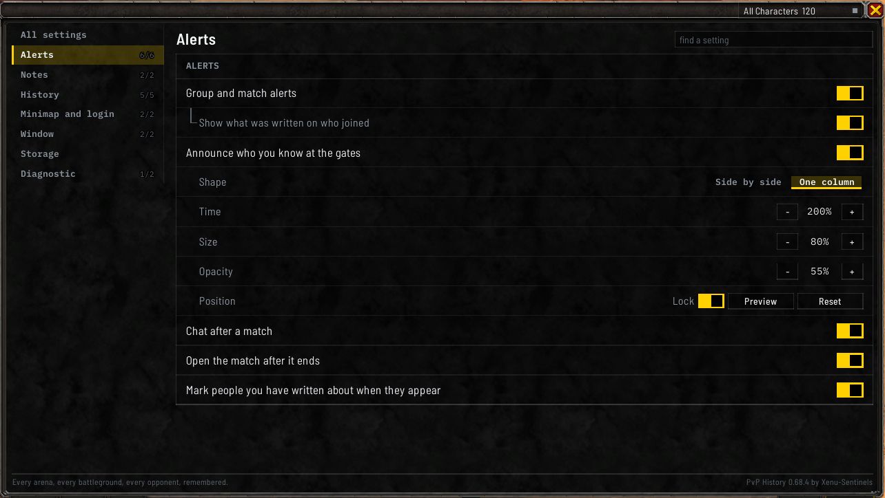
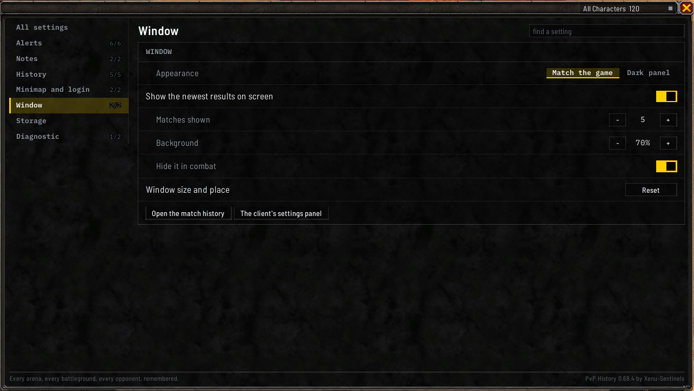

# Settings and storage

## The short version

- Your history is backed up by itself every time you log out.
- To move it to another computer, use **Export** and **Import** under **Storage** in the settings.
- Updating or removing the addon doesn't touch your history.

## Opening the settings

- the **Settings** tab under the match history window, at its bottom right
- `/pvph options`
- the **Settings** entry in the minimap button's right-click menu

The settings are a part of the [match history window](Match-History-Window#the-tabs-under-the-window),
so they take its size and place. `/pvph options` and the minimap menu entry close the window again when
the settings are already showing.

The same switches are also in the game's own settings, under **Options**, **AddOns**. To get there, use
**The client's settings panel** in the addon's **Window** section, or type `/pvph options client`. The
game won't open its settings during combat, so the addon tells you when that's why nothing happened.

It doesn't matter where you change a setting: the window, the game's settings and the `/pvph` commands
all change the same thing.

## How it's laid out

The sections are listed down the left: **All settings**, **Alerts**, **Notes**, **History**,
**Minimap and login**, **Window**, **Storage** and **Diagnostic**, each with how many of its switches
are on, such as `4/4`. Click one to show it. **All settings** shows every section at once, in two
columns where the window is wide enough.

Each setting is a row with a switch at the right. A switch that only works with another one on is
indented under it. Hover a row to see what it does.

**The find box** at the top right narrows the rows to the ones matching what you type.

`/pvph options` followed by a section's word opens the window on that section: `all`, `alerts`, `notes`,
`history`, `minimap`, `window`, `storage` or `diagnostic`. `/pvph options all storage`, for example, opens
**All settings** scrolled to **Storage**.

## What's in each section

**Alerts**, under **ALERTS**:

- **Group and match alerts**, and under it **Show what was written on who joined**
- **Announce who you know at the gates**, with **Shape** (**Side by side** or **One column**),
  **Time**, **Size**, **Opacity**, and **Position**, which holds **Lock**, **Preview** and **Reset**
- **Chat after a match**
- **Open the match after it ends**
- **Mark people you have written about when they appear**

See [Alerts](Alerts) and [After a match](Match-History-Window#after-a-match). **Chat after a match**
covers the lines the addon prints after a match or a duel. With it off, the routine lines stay quiet,
and a line reporting a fault still prints. `/pvph postgame on` and `off` do the same.

**Notes**, under **WHERE YOUR NOTES SHOW UP**: **Unit tooltip lines** and **Right-click menu entry**.

**History**, under **HISTORY**:

- **Record duels**
- **Hold the exit while the scoreboard is read**: when a match ends, the leave button is covered for a few
  seconds so the addon can finish reading the scoreboard. It lets go as soon as the match is saved. See
  [When a match ends](Alerts#when-a-match-ends).
- **Remember the selected tab**
- **Season record beside the group finder**: see [In the group finder](Alerts#in-the-group-finder)
- **Dock the season record to the group finder**: on by default. Turn it off to drag the season record
  anywhere on the screen. See [In the group finder](Alerts#in-the-group-finder)

**Minimap and login**, under **MINIMAP AND LOGIN**: **Minimap button** shows or hides the button, and
**Reset** on **Button position** puts it back, beside a note of where it sits around the minimap. Drag
the button to move it around the minimap's edge, or hold `Shift` while you drag to put it anywhere on
the screen. A plain drag on a button you placed freely puts it back on the edge. `/pvph minimap where`
says where it is. **Name the version at login** is the last row.

**Window**, under **WINDOW**:

- **Appearance**: **Match the game** uses the game's own window frames and colours, and is the
  default. **Dark panel** is the addon's own flat dark look. The change applies straight away, to
  every window already open. `/pvph appearance game` or `/pvph appearance dark` tries one out until
  you log out or reload without changing your setting, and `/pvph appearance stored` goes back to the
  one you picked.
- **Show the newest results on screen**, with **Matches shown**, **Background** and **Hide it in
  combat**, for the [recent results bar](Match-History-Window#the-recent-results-bar)
- **Window size and place**: **Reset** puts every window the addon has back at its normal size and
  place, puts any match windows back beside the match list, and puts the recent results bar back.
- **Open the match history**, which switches to the **History** tab, and **The client's settings panel**

**Storage** and **Diagnostic** are described below.

## How much room is left

The game can only load an addon's saved file up to a certain size. **STORED HISTORY**, at the top of
**Storage**, shows how much of that room your history is using, as a bar that changes colour as it
fills, with about how many more matches fit. `/pvph size` shows the same in chat, with what's taking up
the space.

## Backups

**Your history is backed up automatically every time you log out.** The backup is kept in your
character's own saved file.

Under **BACK UP AND RESTORE**:

- **Back up now** (or `/pvph backup`) makes one straight away.
- Two cards hold the copies you can go back to: **Latest**, the newest backup, and **Pinned**, the copy
  kept when you last erased everything (or **Nothing pinned**). Click one to choose it.
- **Read the chosen copy** shows what that copy holds, and **Restore the chosen copy** replaces your
  history with it.

`/pvph restore` shows what the latest backup holds, and `/pvph restore confirm` replaces your history
with it.

## Moving your history to another character or computer

**OUT OF THE GAME** has **Export** and **Import** (or `/pvph export` and `/pvph import`). Export gives you
your whole history as one block of text to copy, and Import takes one pasted back in.

**Import replaces your matches, players and notes, and keeps this computer's own setup**: your settings,
the list of characters that have logged in here, and the last error the addon hit. A restore from a
backup is different: it's your own character's copy, so it brings back the settings too.

**Keep that text private.** It holds the names of everyone you've played with, and it can be read outside
the game.

### As a spreadsheet

`/pvph export csv` gives you your history as a CSV file you can open in a spreadsheet, with one row per
player in each match. You can narrow it down:

- a format word, such as `shuffle` or `bg`
- `since` and a date written as `YYYY-MM-DD`
- `last` and a number, for your most recent matches

For example, `/pvph export csv shuffle last 20`. A large history comes out in several parts, each a
complete file; add the part number to the command to get the next one.

`/pvph import csv` reads a CSV file back in. It adds matches you don't already have and skips the ones
you do, so you can combine the history from two computers. A file that was changed after it was exported
is refused unless you add `force`. A file exported by an older version of the addon has different columns
and is refused, so update the addon on the other computer and export it again. The command refuses
`since` with no date, `last` with no number, and two format words, rather than treating them as a format.

An import, of a CSV or of pasted text, is refused while a match is being recorded, until the match is
saved. An export is refused while the [sandbox](Commands#trying-the-windows-on-made-up-matches) is up,
since it would hold the made-up matches; a `/reload` brings your own history back first.

The CSV holds your matches and their players, but not your notes or settings. A World PvP session goes
in with its zone, dates and length, and without its kills and deaths. To move everything, use the
regular export.

## Rebuilding the players list

**Rebuild the index**, on **Rebuild who you met** under **OUT OF THE GAME** (or `/pvph rebuild`),
rebuilds the [players list](Players-and-Notes) from your saved matches. You won't normally need it.

## Starting over

**ERASE EVERYTHING STORED**, at the bottom of **Storage**, says what erasing would remove, and its
**Erase** button does it. `/pvph reset` shows the same in chat. It deletes every match, the players
list, your notes and your unfinished matches, and puts the settings back to their defaults.

It asks you to confirm first, and it keeps a copy before erasing: the **Pinned** copy under **BACK UP
AND RESTORE**. The confirm window says what will happen to the pinned copy before you click **Erase**.
Where an older pinned copy is larger, it's kept rather than overwritten, and the window says so. `/pvph restore pinned` followed by `confirm` brings the pinned copy
back, as long as your character's saved file hasn't been deleted.

Restore, Import and Erase all replace or remove your whole history, so each one shows you what it's about
to do and needs a second click.

## Where your history is kept

Your history isn't inside the addon's folder. The game keeps it in its `WTF` folder, inside `_retail_`:

- `WTF\Account\<your account>\SavedVariables\WowPvpHistory.lua` holds your matches, players, notes and
  settings, shared by every character on the account.
- `WTF\Account\<your account>\<realm>\<character>\SavedVariables\WowPvpHistory.lua`, one per character,
  holds that character's backups and debug log.

The game writes these files when you log out, type `/reload` or exit, so only copy or change them with
the game closed.

## Updating the addon

Exit the game, copy the new `WowPvpHistory` folder over the old one in `Interface\AddOns`, including
`fonts` and `textures`, and start the game again. Your history is kept, because it isn't in that folder.
`/pvph status` says which version loaded.

If you installed it through the CurseForge app, the app updates it for you. It's the same zip as the
release download.

## Removing the addon

Delete the `WowPvpHistory` folder from `Interface\AddOns`. Your history files stay where they are, so
installing the addon again later brings everything back. To remove your history as well, delete the
`WowPvpHistory.lua` files listed above with the game closed.

## Diagnostic

Under **DIAGNOSTIC**: **Debug ring** and **Debug detail on screen**, then **Copy** on **The ring** and
**Open** on **Read the state of the store**. These are for reporting problems. See
[Debug log](Debug-Log).
