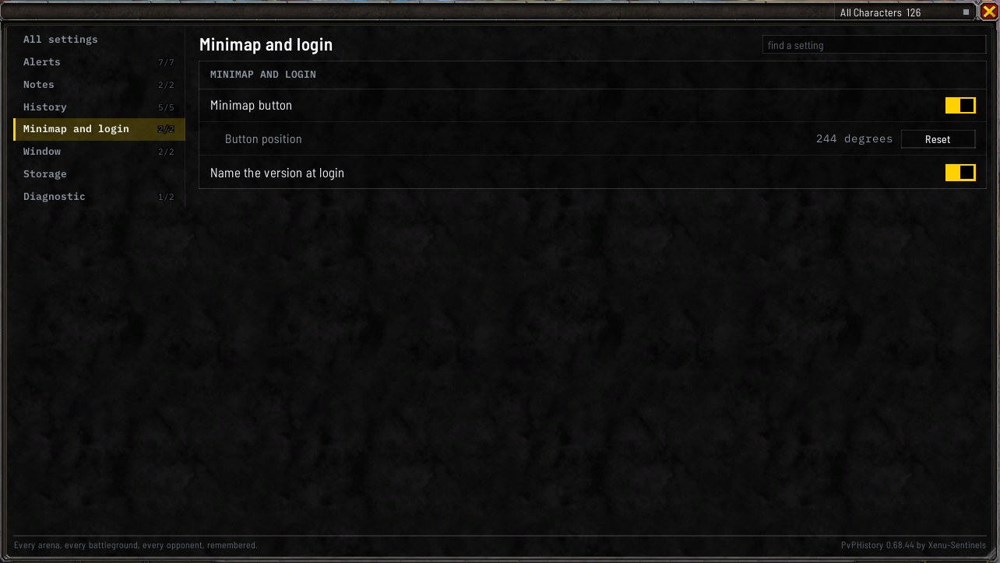
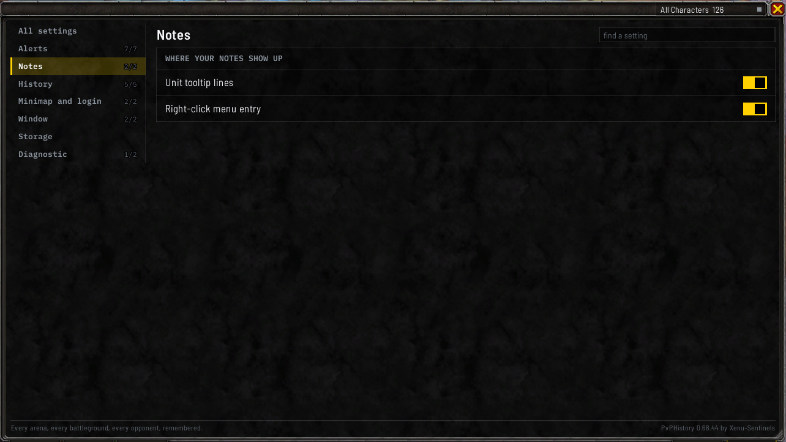
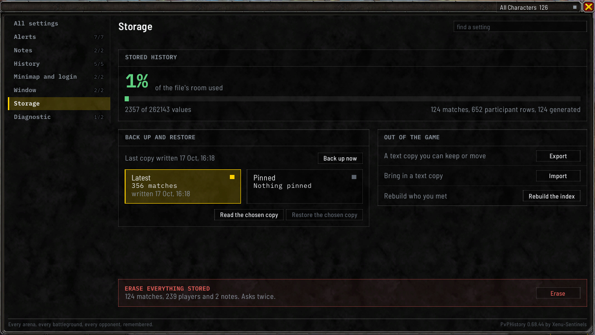
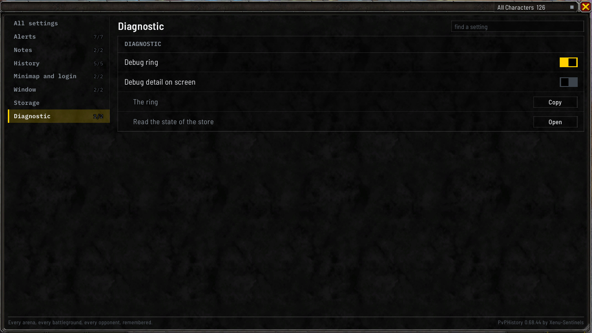

# Settings and storage

## The short version

- Your history is backed up by itself every time you log out.
- To move it to another computer, use **Export** and **Import** on the **Data and backups** page of the settings.
- Updating or removing the addon doesn't touch your history.

## Opening the settings

- the **Settings** tab under the match history window, at its bottom right
- `/pvph options`
- the **Settings** entry in the minimap button's right-click menu

The settings are a part of the [match history window](Match-History-Window#the-tabs-under-the-window),
so they take its size and place. `/pvph options` and the minimap menu entry close the window again when
the settings are already showing.

Most of the same switches are also in the game's own settings, under **Options**, **AddOns**. The
debug switches, the announcement's **Layout** and **Lock**, and the results bar's **Matches shown**,
**Background** and **Hide in combat** are only in the addon's window. To get there, click **Game settings
panel** on the **WINDOWS** card of the **General** page, or type `/pvph options client`. The game won't
open its settings during combat, so the addon tells you when that's why nothing happened.

It doesn't matter where you change a setting: the window, the game's settings and the `/pvph` commands
all change the same thing.

## How it's laid out

The pages are listed down the left: **General**, **Alerts**, **Notes and players**, **Recording** and
**Data and backups**, with **Diagnostic** as a dim word at the foot of the list. Click one to show it; its
name heads the pane beside the list. Each page is a few cards with a title such as **RESULTS ON SCREEN**,
and each setting is a row on a card with its switch at the right.

Every switch reads **On** or **Off** in a word beside it. A setting that only works with another one on
stands indented under it behind a thin rule, and goes dim and stops answering while the switch it needs
reads **Off**. Hover a row to see what it does, whether or not it answers.

**The find box** at the top of the page list searches every page. It matches a row's name, a button's
word such as **Export** or **Import**, and the words you would use for it, such as `backup` or `index`. The
rows it finds show under an **Every page** heading, with the pages they belong to stacked down the pane, a
found row that depends on a switch showing with its switch above it. Clearing the box, or picking a page,
brings the page back.

`/pvph options` followed by a page's word opens the window on that page: `general`, `alerts`, `notes`,
`recording`, `data` or `diagnostic`. The older words still work: `window` and `minimap` open **General**,
`history` opens **Recording**, `storage` opens **Data and backups**, and `all` opens **General**, or the
page of the word after it, as in `/pvph options all storage`.

## What's on each page

**General**:

- **APPEARANCE**: **Look**, where **Match the game** uses the game's own window frames and colors and is
  the default, and **Dark panel** is the addon's own flat dark look. The change applies straight away, to
  every window already open. **Scale**: the minus and the plus draw every PvPHistory window one step smaller or larger,
  text included, from 70% to 150% in steps of 5, and the figure between them is the size the windows
  draw at now. It's the same setting as the **Window scale** slider in the game's own settings. The
  announcement keeps its own size. `/pvph window scale` and a percentage tries a size until you log out
  or reload without changing your setting, and `/pvph window scale reset` goes back to the one you
  picked. A window you move while trying a size stays where you left it.
- **RESULTS ON SCREEN**: **Show the newest results**, with **Matches shown**, **Background** and **Hide
  in combat** under it, for the [results bar](Match-History-Window#the-recent-results-bar).
- **MINIMAP AND LOGIN**: **Minimap button** shows or hides the button, and **Reset** on **Position** under
  it puts it back, beside a note of where it sits around the minimap in whole degrees, such as `243°`.
  Drag the button to move it around the minimap's edge, or hold `Shift` while you drag to put it
  anywhere on the screen. A plain drag on a button you placed freely puts it back on the edge.
  `/pvph minimap where` says where it is, in the same degrees. **Name the version at login** is the
  last row.
- **WINDOWS**: **Remember the selected tab**; **Close match and player windows with the main window**,
  on to start, which while on closes every match window and player window whenever you close the main
  window (`/pvph closeall on` and `/pvph closeall off` do the same); and **Reset all** on **Size and
  place of every window**, which puts every window the addon has back at its normal size and place,
  puts any match windows back beside the match list, and puts the results bar back. **Game settings
  panel** on the card's title row opens the addon's page in the game's own settings.

Every card on **General** fits the window at its normal size, with nothing to scroll.

**Alerts**:

- **IN A GROUP**: **Group and match alerts**, and under it **Show what was written on who joined**.
- **AT THE GATES**: **Announce who you know**, with **Layout** (**Side by side** or **One column**),
  **Shown for**, **Size**, **Opacity**, and **Position**, which holds **Lock**, **Preview** and **Reset**.
  A small picture of the announcement at the right of the card, one player for each side drawn at the
  size of the words beside it, shows how it will draw with what you have set.
- **AFTER A MATCH**: **Chat line after a match** and **Open the match window**.

See [Alerts](Alerts) and [After a match](Match-History-Window#after-a-match). **Chat line after a match**
covers the lines the addon prints after a match or a duel. With it off, the routine lines stay quiet,
and a line reporting a fault still prints. `/pvph postgame on` and `off` do the same.

**Notes and players**:

- **WHERE YOUR NOTES SHOW**: **Unit tooltip lines** and **Right-click menu entry**.
- **IN CHAT**: **A bar before their name**, the mark before the name of somebody you wrote about when
  they talk in chat.
- **ON NAMEPLATES**: **A mark on their nameplate**, the mark on somebody you wrote about when they
  appear.

Searching the find box for `mark` or `written` finds both.

**Recording**:

- **WHAT IS RECORDED**: **Record duels**, and **Hold the exit while the scoreboard is read**: when a match
  ends, the leave button is covered for a few seconds so the addon can finish reading the scoreboard. It
  lets go as soon as the match is saved. See [When a match ends](Alerts#when-a-match-ends).
- **GROUP FINDER**: **Season record beside the group finder**, see
  [In the group finder](Alerts#in-the-group-finder), and under it **Dock it to the group finder**, on by
  default. Turn it off to drag the season record anywhere on the screen.

**Data and backups** and **Diagnostic** are described below.

## How much room is left

The game can only load an addon's saved file up to a certain size. **STORED HISTORY**, at the top of
**Data and backups**, shows how much of that room your history is using, as a bar that changes color as it
fills, with about how many more matches fit. `/pvph size` shows the same in chat, with what's taking up
the space.

## Backups

**Your history is backed up automatically every time you log out.** The backup is kept in your
character's own saved file.

Under **BACK UP AND RESTORE**:

- **Back up now** (or `/pvph backup`) makes one straight away.
- Two cards hold the copies you can go back to: **Latest**, the newest backup, and **Pinned**, the copy
  kept when you last erased everything (or **Nothing pinned**). Click one to choose it.
- **Read the chosen copy** shows what that copy holds, and **Restore the chosen copy** replaces your
  history with it.

`/pvph restore` shows what the latest backup holds, and `/pvph restore confirm` replaces your history
with it.

## Moving your history to another character or computer

**OUT OF THE GAME** has **Export** and **Import** (or `/pvph export` and `/pvph import`). Export gives you
your whole history as one block of text to copy, and Import takes one pasted back in: paste it into
the box and click **Read the paste**, which says what the paste holds and changes nothing, then click
the button again, now reading `Replace 120 with 140` or similar, to replace your history with it.

**Import replaces your matches, players and notes, and keeps this computer's own setup**: your settings,
the list of characters that have logged in here, and the last error the addon hit. A restore from a
backup is different: it's your own character's copy, so it brings back the settings too.

**Keep that text private.** It holds the names of everyone you've played with, and it can be read outside
the game.

### As a spreadsheet

`/pvph export csv` opens a window holding your history as CSV text, with one row per player in each
match. Press Ctrl+A then Ctrl+C to copy it, and save it outside the game as a `.csv` file to open in a
spreadsheet. You can narrow it down:

- a format word, such as `shuffle` or `bg`
- `since` and a date written as `YYYY-MM-DD`
- `last` and a number, for your most recent matches

For example, `/pvph export csv shuffle last 20`. A large history comes out in several parts, each a
complete file; add the part number to the command to get the next one. An export taken during a World PvP
outing leaves that outing out until it ends and says so, so importing the file later adds no second copy.

`/pvph import csv` opens a window to paste a CSV's text into; click **Import** to read it in. It adds matches you don't already have and skips the ones
you do, so you can combine the history from two computers. A file that was changed after it was exported
is refused unless you add `force`, which turns the button into **Import, forced**. A file from an older version that only lacks columns this version
added still imports, with those cells left empty. A file whose columns this version no longer has, or one
from a newer version, is refused, so bring both computers to the same version and export it again. The command refuses
a format word you have no matches in, saying which formats you do have, and
`since` with no date, `last` with no number, and two format words, rather than treating them as a format.

An import, of a CSV or of pasted text, is refused while a match is being recorded, until the match is
saved. An export is refused while the [sandbox](Commands#trying-the-windows-on-made-up-matches) is up,
since it would hold the made-up matches; a `/reload` brings your own history back first.

The CSV holds your matches and their players, with the talent loadout and talent string you played
where the match saved them, but not your notes or settings. A World PvP outing goes
in with its zone, dates and length, and without its kills and deaths. To move everything, use the
regular export.

## Rebuilding the players list

**Rebuild the index**, on **Rebuild who you met** under **OUT OF THE GAME** (or `/pvph rebuild`),
rebuilds the [players list](Players-and-Notes) from your saved matches. You won't normally need it.

## Starting over

**ERASE EVERYTHING STORED**, at the bottom of **Data and backups**, says what erasing would remove, and its
**Erase** button does it. `/pvph reset` shows the same in chat. It deletes every match, the players
list, your notes and your unfinished matches, and puts the settings back to their defaults.

It asks you to confirm first, and it keeps a copy before erasing: the **Pinned** copy under **BACK UP
AND RESTORE**. The confirm window says what will happen to the pinned copy before you click **Erase all of it**, which
then reads `Click again to erase`.
Where an older pinned copy is larger, it's kept rather than overwritten, and the window says so. `/pvph restore pinned` followed by `confirm` brings the pinned copy
back, as long as your character's saved file hasn't been deleted.

Restore, Import and Erase all replace or remove your whole history, so each one shows you what it's about
to do and needs a second click.

## Where your history is kept

Your history isn't inside the addon's folder. The game keeps it in its `WTF` folder, inside `_retail_`:

- `WTF\Account\<your account>\SavedVariables\WowPvpHistory.lua` holds your matches, players, notes and
  settings, shared by every character on the account.
- `WTF\Account\<your account>\<realm>\<character>\SavedVariables\WowPvpHistory.lua`, one per character,
  holds that character's backups and debug log.

The game writes these files when you log out, type `/reload` or exit, so only copy or change them with
the game closed.

## Updating the addon

Exit the game, copy the new `WowPvpHistory` folder over the old one in `Interface\AddOns`, including
`fonts` and `textures`, and start the game again. Your history is kept, because it isn't in that folder.
`/pvph status` says which version loaded.

If you installed it through the CurseForge app or the Wago app, the app updates it for you. It's the
same zip as the release download and the one on [its WoWInterface page](https://www.wowinterface.com/downloads/info27266-PVPHistory.html).

## Removing the addon

Delete the `WowPvpHistory` folder from `Interface\AddOns`. Your history files stay where they are, so
installing the addon again later brings everything back. To remove your history as well, delete the
`WowPvpHistory.lua` files listed above with the game closed.

## Diagnostic

**Diagnostic** is the dim word at the foot of the page list. Under **DIAGNOSTIC**: **Debug ring** and
**Debug detail on screen**, then **Copy** on **The ring** and **Open** on **Read the state of the store**.
These are for reporting problems. See [Debug log](Debug-Log).

