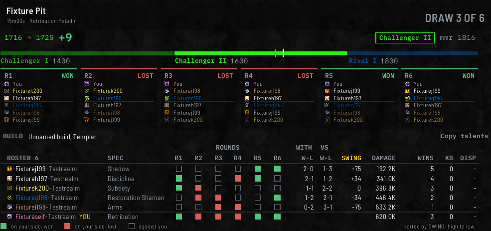

# Solo Shuffle

A Solo Shuffle match is saved with all six rounds: who was on your team each round, who won it, and how
long it took.

## At the top

The result is in large letters at the right of the match's window: **WON 4 OF 6** in your win colour,
**LOST, WON 2 OF 6** in your loss colour, or **DRAW 3 OF 6** in grey. This is the game's own count from
the scoreboard. Where the rounds the addon recorded don't add up to six, it reads **RESULT NOT KNOWN**
rather than guessing.

In the **Match the game** appearance, a card for each round stands under the top of the window: the
round, **WON** or **LOST**, and the six players, yours first.

## The round table

Below that is one table of everyone in the match, the other five players first and your own row last.
Its first column is headed **ROSTER 6**.

| Column | What it shows |
| --- | --- |
| Name and **SPEC** | The player, with their spec's icon and their name in their class colour |
| **R1** to **R6**, under **ROUNDS** | A filled square where that player was on your side in the round, green if you won it and red if you lost it, and an empty square where they were against you |
| **W-L**, under **WITH** | How you did in the rounds they were on your team |
| **W-L**, under **VS** | How you did in the rounds they were on the other team |
| **SWING** | The difference between the two: who you did best with |
| **DAMAGE**, **WINS**, **KB** and **DISP** | Their damage, the rounds they won on the scoreboard, their killing blows and their dispels |

A line under the table explains the three squares. The table starts sorted by **SWING**, and the note
at the bottom right says how it's sorted. Click **SWING**, **DAMAGE**, **WINS**, **KB** or **DISP** to
sort on that column, and click it again to turn it around. `/pvph scoreboard sort` with `swing`,
`damage`, `wins`, `kb` or `dispels`, and `up` or `down`, sorts it from chat until you log out or
reload. Two players on the same spec each keep their own row and their own figures.

Your own row shows whether you won or lost each round, and your figures. A round with no known result
is drawn as not known. `/pvph` and the match number prints the same match in chat, with each player's
role and win rates as well.

Hover over a round to see how many dispels that player cast in it, under **DISPELS**. Round 6's figure is
worked out from the match's totals, and `/pvph meter` with the match number marks it `(worked out)`.

## How the addon knows who won each round

The scoreboard doesn't say who won each round. The addon watches the round counter at the top of the
screen during the match and works it out from that.

If it missed a round, it works the rounds out from each player's **Rounds Won** total on the
scoreboard. That settles most matches, but not all of them. Where the rounds it saved still don't add
up, but every player's **Rounds Won** total is there and they agree, your result is read from those
totals instead.

Solo Shuffles saved before version 0.11.0 don't have the round counter, so they rely on the scoreboard
totals alone.

## Filling in a missing round

If a round has no result, you can fill it in yourself in your own row:

- **Left-click** the round to mark it won.
- **Right-click** to mark it lost.
- **Click it again** to clear it.

A result you entered shows an asterisk, like **WON\***. Rounds the addon already knows can't be changed.

The addon won't let you enter a result that can't be true given the scoreboard totals, and tells you in
chat if you try. Sometimes entering one round settles several others.

Results you enter show up in this match's table, but they don't change the headline (the game's own
count) or your [compositions](Compositions), which only use results the addon recorded itself.

## Elsewhere

- **Win rate**: a Solo Shuffle counts as a win if you won most of its rounds, and 3-3 is a draw, left
  out of the rate. See [Summary and rating graph](Summary-and-Rating-Graph).
- **The session list**: a session's **ROUNDS** adds up the rounds of its Solo Shuffles. Where one of
  them has no rounds the addon could add up, the figure is dimmed, and hovering it says how many
  of the session's matches it covers. See
  [The match list](Match-History-Window#the-match-list).
- **Compositions**: each round counts separately, not each match. See [Compositions](Compositions).
