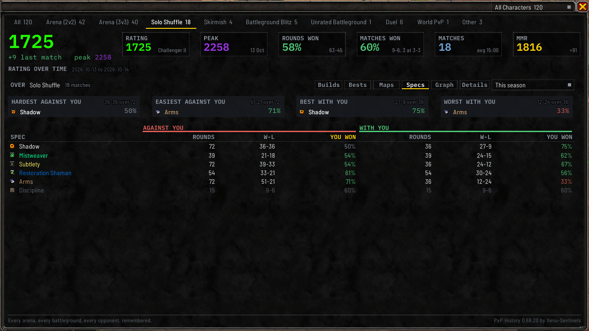

# Specs

The spec table lists every spec you've met in rated Solo Shuffle, with how you did against it and how
you did with it on your team. Pick the rated Solo Shuffle tab, click **Stats** under the window, and
click **Specs** in the row of controls. Other tabs don't offer it, because only Solo Shuffle deals new
teams every round.

For the whole teams you've faced, see [Compositions](Compositions). For the one spec that beats you
most, or the one you do best beside, see **WHAT BEATS ME** and **BEST TEAMMATE** in [Ask](Ask).

## The spec table

Each row is a spec, with its icon and its name in its class colour, and two sides:

- **AGAINST YOU**: the **ROUNDS** you faced it, your **W-L** in them, and **YOU WON**, your win rate.
- **WITH YOU**: the same, for rounds where it was on your team.

Click any heading to sort by it, and click it again to turn the order around. Where you've only ever
met a spec on one side, the other side says so, such as `never yet alongside you`.

Click a spec to list the matches you met it in, under **MET IN**, with headings of their own: **MATCH**,
**WHEN** with the date, **WHERE** with the map beside the six round squares, **ROUNDS**, **CHANGE** in
colour and **RATING** in its tier colour. Clicking a match opens its window.

**YOU WON** is your own win rate in those rounds, not that spec's. The two **ROUNDS** columns don't add
up to your rounds played, because a spec counts once per round on whichever side it was.

Four cards name the spec that's **HARDEST AGAINST YOU**, the one that's **EASIEST
AGAINST YOU**, the one you do **BEST WITH YOU** and the one you do **WORST WITH YOU**. A spec needs 20
rounds on a side before a card can name it.

Click **Specs** again to go back to the [Ask](Ask) cards. `/pvph ask specs on` and `off` open and
close it for the session, and `/pvph ask specs sort` and a column sorts it from chat.

## Narrowing it down

The [time range dropdown](Summary-and-Rating-Graph#choosing-a-time-range) and the
[character dropdown](Match-History-Window#showing-one-character) both apply here.

`/pvph ask shuffle` prints the **WHAT BEATS ME** and **BEST TEAMMATE** answers in chat.
