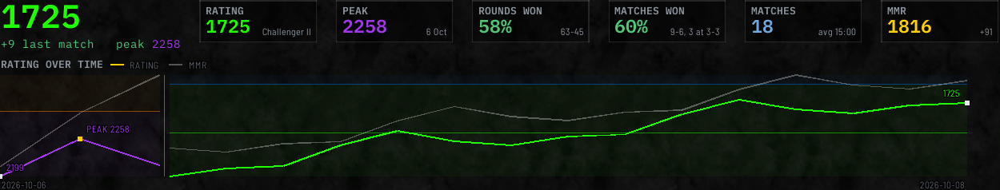
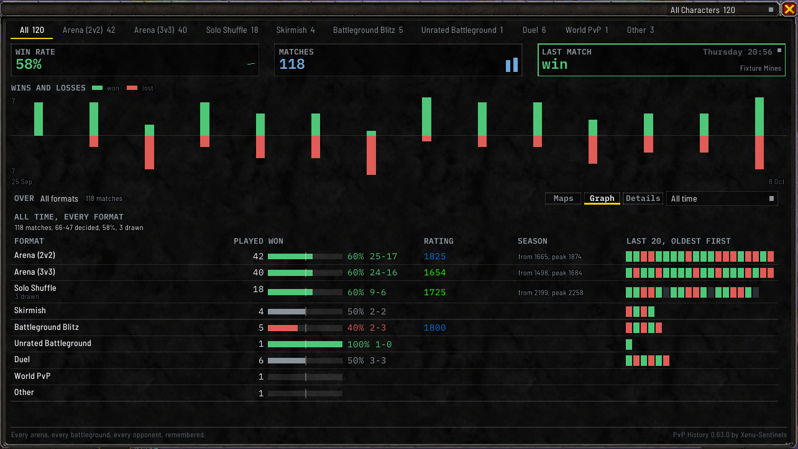

# Summary and rating graph

The figures and the rating graph are at the top of the **Stats** tab, for the format tab you're on.
The **History** tab has a strip of its own, described under
[Your standing, above the list](Match-History-Window#your-standing-above-the-list). `/pvph summary`
prints the same figures in chat.

## The figures

**On a rated tab**, your rating stands at the left in large figures, in the colour of your PvP tier,
with what your last match changed it by and your peak under it. Beside it is a row of cards:

- **RATING**: your rating, with the tier's name beside it.
- **PEAK**: your highest rating, with the day you reached it.
- **ROUNDS WON**: on Solo Shuffle, the share of rounds you won, with the rounds won and lost.
- **MATCHES WON**: the share of matches you won, with your wins and losses.
- **MATCHES**: how many matches the tab holds in the time range you picked, with your average match
  length.
- **MMR**: your matchmaking rating, where the game reported one, with how far it is from your rating:
  `+91`, `-17`, or `0` when they're level.

Every rating you see for yourself takes the colour of the tier its own number falls in, so a climb
across a tier's starting rating shows two colours. Other players' ratings keep the normal colour.

**On any other tab**, the cards are:

- **WIN RATE**: how often you won.
- **MATCHES**: how many matches the tab holds in the time range you picked.
- **MMR**: your matchmaking rating, on a tab where the game reported one.
- **AVG LENGTH**: how long your matches take, shown only where every match in range has a length.
- **LAST MATCH**: your newest match on the tab. See below.

Hover over a card for the figures behind it. A figure with nothing to count isn't shown, rather than
showing zero.

**WIN RATE**, **MATCHES** and **AVG LENGTH** each carry a small picture of how that figure moved over
your newest twelve weeks on the tab: the win rate and the length as a line, and the matches as one bar
per week. **WIN RATE** is green above 50%, red below and grey at exactly 50%. In a narrow window the
picture is what gives way first, and a second figure on a card steps down to a shorter form, such as
`9-6` for **MATCHES WON** or `7 Sep` for **PEAK**, or is left off, so nothing is cut.

### The last match card

**LAST MATCH** shows the result of your newest match on the tab in your win or loss colour, with the
map, the day and the time. Click it to open that match's window, and click it again to close it. A tab
with no matches shows a dash.

### How wins are counted

A match counts as won or lost based on:

1. the result the game showed, or if there wasn't one,
2. a result you entered yourself, or if there wasn't one,
3. whether you won most of the rounds (so a Solo Shuffle where you won 4 of 6 rounds is a win).

**A draw is left out** of both the count and the rate, and named apart: `9-6, 1 drawn`, or on Solo
Shuffle `9-6, 3 at 3-3`. A match that none of these can decide isn't counted either.

**Details**, in the row of controls on **Stats**, opens a few lines under the graph saying what's behind
each figure: your wins and losses, how far your matchmaking rating is from your rating, your record on
each side in battlegrounds, and, on tabs with rounds, the share of rounds you won. The last one can be
quite different from the win rate: winning about half your rounds but only a quarter of your Solo
Shuffles means you're often going 3-3. Click **Details** again to close it.

## Choosing a time range

The dropdown at the right end of the row of controls on **Stats** picks which matches everything is
based on. The same dropdown stands at the right end of the search row on **History**, and a pick in
either place moves both:

- **This season**
- an earlier season, listed below **This season** and above **All time**, newest first, by the name the
  season was given or `Season <n>`
- **All time**
- **Last 6 months**, **Last 3 months**, **Last month**, **Last week**, **Last 3 days** or **Last day**

The figures, the graph, the match list, the [compositions](Compositions), the [specs](Specs) and the
[Ask](Ask) answers all follow it, and your choice is remembered, an earlier season included.

**This season** only appears on rated tabs, since unrated matches, skirmishes and duels don't have
seasons. Those tabs show **All time** unless you pick a range. An earlier season is listed only where
the tab holds matches from it, so picking one never opens an empty view. `/pvph show` with `season<n>`
opens the window on one.

If you open a tab that has matches but none this season, the dropdown switches to **All time** for you
so you're not looking at an empty window. That only applies to that tab and isn't saved.

To see figures for an older season, type `/pvph summary`, a format word and the season number, such as
`/pvph summary shuffle` followed by the number. The format words are listed on the [Commands](Commands)
page.

## The rating graph

**RATING OVER TIME** shows your rating over time, with the numbers along the side. The line takes the
colour of each tier it passes through, over a band for each tier, and the first rating of the season is
marked. Your peak and your last match are marked, and the first and last day it covers are written
under it.

**It needs three matches with a rating to draw a line.** A tab with fewer shows no graph, and the list
under it takes its room.

**Graph**, in the row of controls, folds it away to a single line with the dates it covers. Click it
again to bring it back. Your choice is remembered. `/pvph fold` with `graph` or `details` and `open` or
`shut` folds either one from chat, for that session only.

**If the window is short**, the graph keeps its shape and drops the numbers along its side rather than
squeezing them.

**Your matchmaking rating is drawn as a grey second line**, labelled **MMR**, wherever it differs from
your rating and enough of your matches in a row recorded one. Where too few in a row did, there's no
second line, because it would join matches that weren't next to each other.

**A rating that looks wrong is left off.** If a match's rating is more than 1,000 away from where the
previous match ended, it's almost certainly a bad reading from the game, not a real result. It's left
off the graph and out of the peak, and counted as skipped. Your saved match isn't changed.

## The All tab

**All** has no rating line, since its matches come from every format. Its **Stats** shows:

- **WINS AND LOSSES**: one bar for each day you could have played, from the first day you played in
  the range to the last, wins rising above the line and losses falling below it. A range longer than
  90 days takes a bar a week, and one longer than 27 weeks a bar a month. A day you didn't play keeps
  its place, empty. The tallest count is written at the left, and the first and last day under the
  chart.
- **A table of every format**: what you **PLAYED**, how many you **WON**, your **RATING** now, the
  **SEASON** you started at and your peak in it, and your **LAST 20** results, oldest first.
- **BY WEEK** and **WHEN YOU WIN**, by weekday and hour, in a window tall enough to hold them.

## Who was fought, on the Duel tab

Duels have no rating, so the **Duel** tab's **Stats** shows **WHO WAS FOUGHT** where the graph would
be: the opponents you've dueled most, each with your wins and losses against them, in your win colour
if you're ahead and your loss colour if you're behind. The **History** tab's **WHO YOU DUEL** panel lists
them all. See [Duels and unfinished matches](Duels-and-Unfinished-Matches).

## Seasons

Each match remembers the season it was played in. The graph breaks at the start of each season, since
ratings reset there.

On **All time**, each season gets its own section of the graph, and a section needs three rated matches
of its own to draw a line. A shorter season shows its matches as dots instead. The side of an
all-time graph carries no numbers, because each season is on its own scale.

Matches saved before the addon started recording seasons don't know which season they belong to. You
can mark when a season started with `/pvph season start`, the season number, and the date as
`YYYY-MM-DD` (leave the date out to mean right now). The addon then places those older matches by date.
`/pvph season end`, `label` and `forget` adjust what you've marked, and never change a season a match
recorded itself.

`/pvph season` on its own shows what the game reports and what you've marked, then compares the game's
own count of your rated matches this season and this week with what the addon has saved.

`/pvph tiers` prints each rated format's tiers and the rating each one starts at, as the game reports
them.
