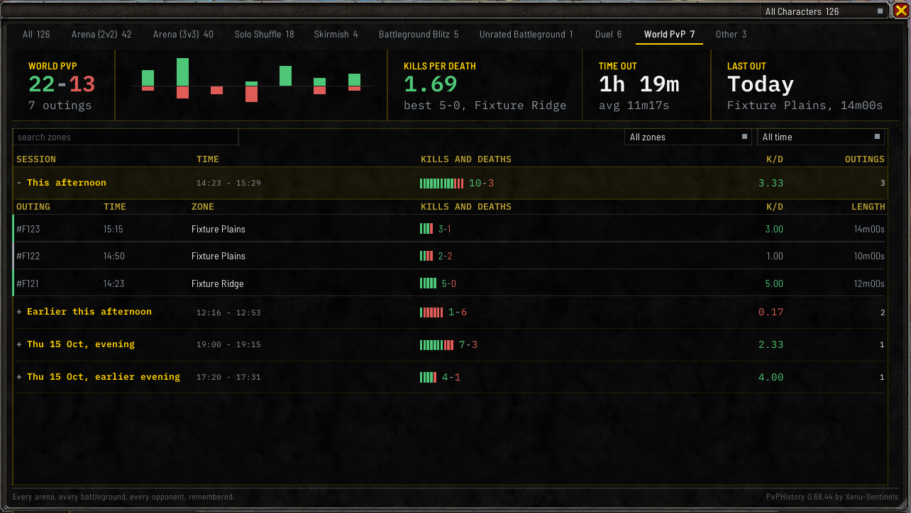
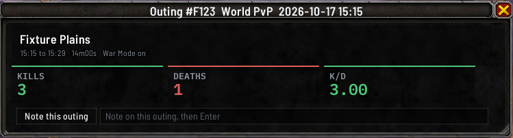

# World PvP

With War Mode on, the addon saves your fights in the open world as outings. Each outing counts your
honorable kills and your deaths, and your outings have their own **World PvP** tab in the
[match history window](Match-History-Window).

## When an outing starts and ends

An outing starts with your first honorable kill, or your first death, in the open world with War Mode
on. Nothing inside a dungeon, a battleground or an arena counts, and nothing while War Mode is off.

It ends when 15 minutes pass with no kill and no death, when you enter an instance, or when you log
out. An outing that was still going when the game closed is closed at your next login, as of its last
kill or death.

## What an outing holds

- **Kills**: the game's own count of your honorable kills during the outing.
- **Deaths**: how many times you died in it.
- **Where**: the zone the outing started in.
- **How long**: from its start to its last kill or death.

An outing has no winner, so it has no win rate, takes no typed result, and never becomes the format of
the [recent results bar](Match-History-Window#the-recent-results-bar).

## The World PvP tab

Across the top of the tab:

- **WORLD PVP**: your kills and deaths, with how many outings that is under them.
- A trend with a pair of bars for each of your newest 20 outings, spread across its whole width,
  oldest at the left:
  kills rising in green and deaths falling in red.
- **KILLS PER DEATH**, with your best outing's kills, deaths and zone under it.
- **TIME OUT**: how long you've spent out in hours and minutes, such as `1h 19m`, with the average
  outing under it.
- **LAST OUT**: when your newest outing was.

Under the strip, your outings are grouped into sessions as on every other tab. Each session's line shows
its **TIME**, its **KILLS AND DEATHS** as a green mark for each kill and a red mark for each death with
the two figures beside them, its **K/D** and how many **OUTINGS** it holds.

Each outing in an open session shows **OUTING** with its number, **TIME**, **ZONE**, **KILLS AND DEATHS**,
**K/D** and **LENGTH**. Its edge is green where you killed more than you died, red where you died more,
and gray where they were level.

**The filters** on this tab are a zone dropdown, reading **All zones** until you pick one, and the time
range. The search box searches zones. A spec or result filter picked on another tab doesn't hide your
outings. `/pvph filter zone` with a zone, or `all`, sets the zone from chat. The count beside the search
box shows only while a search or a zone narrows the list, such as `2 of 8 outings`.

## One outing, in its own window

Click an outing to open it. Its title bar reads **Outing** and its number. Under the zone are its start
and end times, its length and whether War Mode was on, then **KILLS**, **DEATHS** and **K/D**.

**Note this outing**, at the bottom, puts the cursor in the note box, which reads
`Note on this outing, then Enter`. Right-clicking an outing in the list offers **Open**,
**Note this outing**, **Print in chat** and **Compare**.

## Where you fight

Click **Stats** on the **World PvP** tab for the same strip as on **History**, then **WHERE YOU FIGHT**
in place of the question cards: a row for each zone with your **OUTINGS**, your **KILLS AND DEATHS** and
your **K/D**, best K/D first. A zone where no outing recorded a kill or a death shows a dash and sorts
last. Click a zone to list its outings, and click an outing to open its window.

## Who you killed

When you land the killing blow on a player, the addon tries to add them to the outing: their name,
class, race and faction, how many times you killed them, and on your own line how many killing blows
you landed. They then appear in the [players window](Players-and-Notes) like anyone else you've met.

When you have that player targeted, the game lets the addon read who they were, and the outing names
them. Whether it can when you had nothing targeted hasn't been checked yet. If it can't, the outing
still counts your kills and deaths, and names nobody for that kill. See
[What it cannot record](What-It-Cannot-Record).
